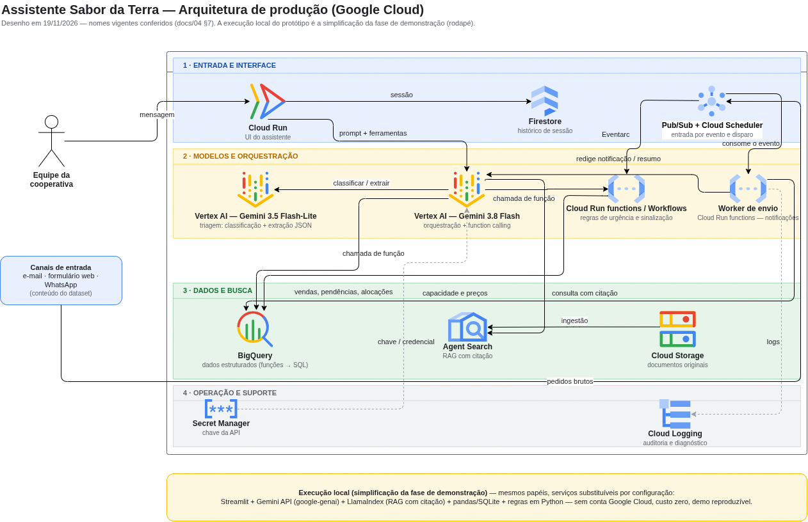
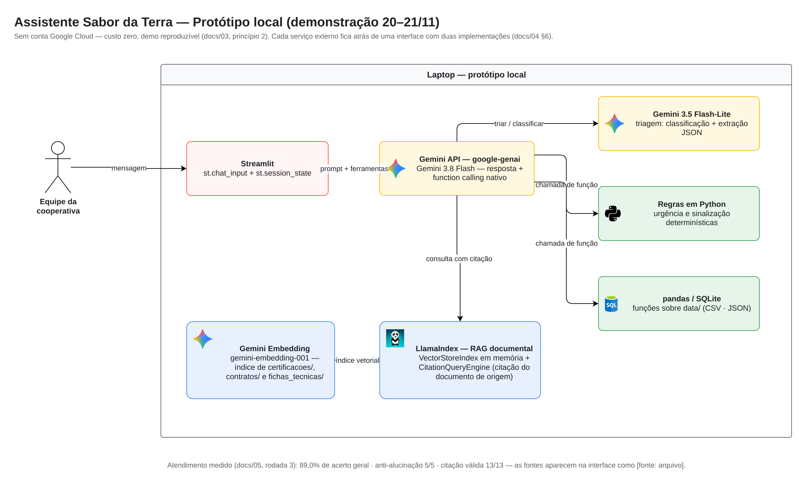
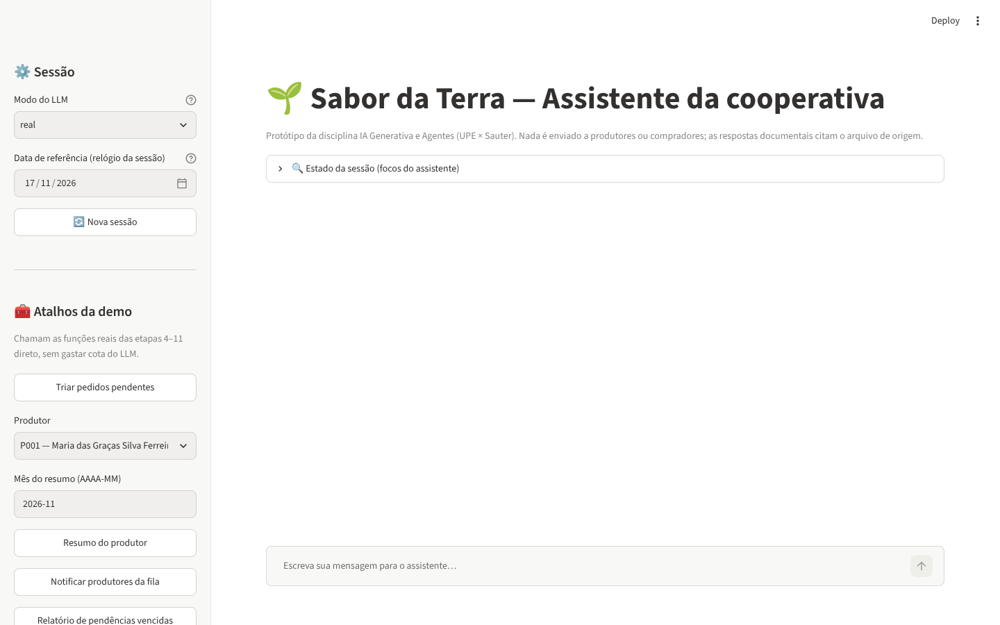

# Sabor da Terra — Assistente Inteligente para Gestão de Cooperativa Agrícola

> Projeto intermediário da disciplina de **IA Generativa e Agentes**
> Universidade de Pernambuco (Campus Garanhuns) × **Sauter Tecnologia** — Novembro de 2026

**O que é:** um assistente de IA conversacional (texto, em português) que atua como apoio à operação da **Cooperativa dos Produtores Rurais Sabor da Terra**, cooperativa fictícia do Agreste Meridional de Pernambuco, resolvendo três gargalos:

| # | Gargalo | O que o assistente faz |
|---|---------|------------------------|
| 1 | **Triagem de pedidos** | Interpreta pedidos em linguagem natural coloquial (e-mail, WhatsApp, formulário web), extrai produtos/quantidades/prazos/comprador, classifica urgência e sinaliza problemas (fora de safra, acima da capacidade) |
| 2 | **Consulta documental** | Responde perguntas sobre certificações, rastreabilidade, sazonalidade e contratos **citando o documento de origem** — nada de resposta sem fundamento |
| 3 | **Comunicação com produtores** | Gera resumos personalizados (vendas, pendências, alocações) e notificações de novos pedidos por produtor |

## Arquitetura em uma página

> **Documento oficial:** [`docs/04-arquitetura.md`](docs/04-arquitetura.md) — entregável obrigatório de 19/11/2026. Fontes editáveis dos diagramas: [`docs/img/`](docs/img/) (`.drawio` + PNG).

**Produção (mundo Google)** — as 4 camadas e os fluxos principais:



1. **Entrada e interface** — a equipe conversa no **Cloud Run** (Streamlit); pedidos chegam por e-mail/formulário/WhatsApp e entram pelo **Pub/Sub + Cloud Scheduler**; a sessão persiste no **Firestore**.
2. **Modelos e orquestração** — o **Gemini 3.8 Flash** (Vertex AI) orquestra por function calling: tria no **Gemini 3.5 Flash-Lite**, chama as **Cloud Run functions / Workflows** (regras de urgência determinísticas) e consulta o **Agent Search** com citação; o **Worker de envio** redige notificações e resumos com dados do BigQuery.
3. **Dados e busca** — **BigQuery** (dados estruturados consultados por funções, nunca colados no prompt), **Agent Search** (RAG documental com citação) alimentado pelo **Cloud Storage**.
4. **Operação e suporte** — **Secret Manager** (chave da API, nunca em variável de ambiente) e **Cloud Logging** (auditoria de respostas e ferramentas).

**Protótipo local (demonstração 20–21/11)** — mesmos papéis, serviços trocáveis por configuração (§6 do `docs/04`): sem conta Google Cloud, custo zero, demo reproduzível.



| Diagrama | Arquivo |
|---|---|
| Sequência do Desafio A — triagem de pedidos | [`docs/img/sequencia-desafio-a.png`](docs/img/sequencia-desafio-a.png) ([`.drawio`](docs/img/sequencia-desafio-a.drawio)) |
| Sequência do Desafio B — consulta documental | [`docs/img/sequencia-desafio-b.png`](docs/img/sequencia-desafio-b.png) ([`.drawio`](docs/img/sequencia-desafio-b.drawio)) |
| Sequência do Desafio C — comunicação com produtores | [`docs/img/sequencia-desafio-c.png`](docs/img/sequencia-desafio-c.png) ([`.drawio`](docs/img/sequencia-desafio-c.drawio)) |

## Regras do jogo (requisitos funcionais)

- Interface **conversacional** por texto para a equipe da cooperativa.
- Entende **português coloquial**: abreviações, erros de digitação, informação implícita.
- Toda resposta documental **indica de qual documento veio**.
- Gera **relatórios e notificações de forma autônoma** quando solicitado.
- Mantém o **contexto da conversa** durante a sessão.
- Quando **não souber a resposta**, diz claramente — **sem inventar**.

## Entregáveis e datas

| Data | Evento |
|------|--------|
| 05/11/2026 | Divulgação da formação dos grupos |
| **19/11/2026** | **Entrega obrigatória da arquitetura** — modificações após esta data são desconsideradas |
| 20–21/11/2026 | Apresentação e demonstração do protótipo funcional |

Entregas finais: **(1)** protótipo funcional com **demonstração ao vivo**; **(2)** apresentação de **10 minutos** explicando decisões técnicas, alternativas consideradas e limitações.

## Guia de navegação

> O avaliador vai navegar pelo repositório — a tabela abaixo leva direto a cada entrega. Os **links do projeto** (desafio, dataset, diretriz) são as fontes de verdade do escopo; os de **arquitetura e avaliação** são os entregáveis.

| Você quer ver… | Vá direto em |
|---|---|
| 🏛️ **A arquitetura final** (documento oficial, obrigatório de 19/11) | [`docs/04-arquitetura.md`](docs/04-arquitetura.md) |
| 📊 **As decisões por componente** — local ↔ Google Cloud, com justificativa e alternativa considerada (dentro e fora do Google) | [§2](docs/04-arquitetura.md#2-tabela-de-mapeamento-por-componente) e [§4](docs/04-arquitetura.md#4-componentes-de-apoio-só-no-desenho) |
| 🧭 **Os diagramas** — produção, protótipo local e as sequências dos 3 desafios | [§8](docs/04-arquitetura.md#8-diagrama), [§12](docs/04-arquitetura.md#12-diagramas-de-sequência-dos-3-desafios) e [`docs/img/`](docs/img/) |
| 💰 **O custo** — estratégia do protótipo e estimativa de produção na escala da narrativa | [§14](docs/04-arquitetura.md#14-custo) |
| 🏗️ **O Well-Architected Framework** — uma decisão concreta por pilar | [§13](docs/04-arquitetura.md#13-google-cloud-well-architected-framework) |
| 🛡️ **O anti-alucinação** — como a citação é validada no protótipo e em produção | [§15](docs/04-arquitetura.md#15-anti-alucinação-citação-validada-no-protótipo-e-em-produção) |
| 🚀 **O caminho para produção** — Terraform, Workflows, Dockerfile e comandos `gcloud` | [`infra/`](infra/) e [§11](docs/04-arquitetura.md#11-caminho-para-produção-etapa-15-issue-15) |
| 📏 **Os resultados da avaliação** — 37 casos, acerto por desafio e por requisito | [`docs/05-avaliacao.md`](docs/05-avaliacao.md) |
| ⚠️ **As limitações e próximos passos** | [§16](docs/04-arquitetura.md#16-limitações-e-próximos-passos) |
| 🎒 **O escopo obrigatório do desafio** (cenário, problemas, requisitos, datas) | [`docs/01-documento-base.md`](docs/01-documento-base.md) |
| 🧨 **As armadilhas escondidas no dataset** | [`docs/02-dataset.md`](docs/02-dataset.md) |
| 📐 **A diretriz de arquitetura** (regras do projeto para toda decisão) | [`docs/03-diretriz-arquitetura.md`](docs/03-diretriz-arquitetura.md) |
| 🧩 **O código de cada desafio** — triagem (A), RAG (B) e produtores (C) | [`sabor_da_terra/`](sabor_da_terra/) |
| 💬 **A interface conversacional** | [`app.py`](app.py) |
| ✅ **Os testes** — suíte completa offline em modo fixture | [`tests/`](tests/) |
| 🖼️ **Capturas de tela da interface** | [`docs/img/01-chat-inicial.png`](docs/img/01-chat-inicial.png) |

## Estrutura do repositório

```
sabor-da-terra-assistente/
├── README.md                ← este arquivo
├── INTEGRANTES.md           ← equipe do projeto
├── CONTRIBUTING.md          ← convenções de branch, commit e PR
├── app.py                   ← interface conversacional em Streamlit (etapa 13)
├── Dockerfile               ← container do app para o Cloud Run, porta 8080 (etapa 15)
├── requirements.txt         ← dependências com versões fixadas
├── .env.example             ← modelo de configuração (copie para .env)
├── docs/
│   ├── 01-documento-base.md ← interpretação completa do documento do projeto
│   ├── 02-dataset.md        ← inventário detalhado dos dados + armadilhas
│   ├── 03-diretriz-arquitetura.md ← diretriz: arquitetura no ecossistema Google
│   ├── 04-arquitetura.md    ← arquitetura final: decisões, diagramas, Well-Architected, custo
│   ├── 05-avaliacao.md      ← avaliação ponta a ponta (37 casos, rodada 3)
│   ├── avaliacao/           ← detalhes de cada rodada da avaliação (JSON)
│   └── img/                 ← diagramas draw.io (+PNG) e capturas de tela da interface
├── infra/                   ← artefatos de implantação no Google Cloud, validados e NÃO aplicados (etapa 15)
│   ├── terraform/           ← serviços do docs/04, contas de serviço e IAM
│   ├── workflows/triagem.yaml ← fluxo da triagem: extração → validações → urgência → alocação
│   ├── bigquery/            ← esquema das tabelas (gerado de dados/esquema.py)
│   └── cloudbuild.yaml      ← pipeline testes → build → deploy no Cloud Run
├── scripts/
│   ├── smoke_llm.py         ← teste de fumaça real (Flash-Lite, Flash e embedding)
│   ├── exemplos_produtores.py ← gera os resumos e notificações de exemplo (etapa 11)
│   └── gerar_esquemas_bigquery.py ← regenera infra/bigquery/ a partir do esquema (etapa 15)
├── exemplos/
│   ├── fila_triagem.md      ← fila de triagem do dia 30/10/2026 (etapa 10)
│   └── produtores/          ← resumos, notificações e respostas a produtores (etapa 11)
├── sabor_da_terra/
│   ├── llm/                 ← cliente único Gemini: modelo por papel, retry 429, modo fixture
│   ├── dados/               ← camada de dados estruturados (etapa 4)
│   ├── regras/              ← motor de regras de negócio (etapa 5)
│   ├── rag/                 ← consulta documental com citação (etapa 7)
│   ├── triagem/             ← triagem de pedidos (etapa 9)
│   ├── produtores/          ← comunicação com produtores (etapa 11)
│   ├── assistente/          ← orquestração com function calling (etapa 12)
│   └── interface/           ← lógica da tela: fila para o st.dataframe, fontes, erros amigáveis (etapa 13)
├── tests/                   ← suíte pytest (roda offline em LLM_MODO=fixture)
│   └── fixtures/llm/        ← respostas reais gravadas para os testes
└── data/                    ← base de dados da cooperativa (cópia de trabalho)
    ├── LEIA-ME.txt
    ├── produtores.csv · pedidos.json · financeiro.csv
    ├── sazonalidade.csv · tabela_precos_outubro_2026.csv · lotes.csv
    └── certificacoes/ (12 docs) · contratos/ (3) · fichas_tecnicas/ (5)
```

## Interface conversacional (etapa 13)

`streamlit run app.py` abre o chat com o assistente orquestrado (etapa 12) —
`st.chat_input`/`st.chat_message`, histórico e estado da sessão no
`st.session_state`. O que aparece na tela:

- **Chat:** converse em português; o assistente chama as funções das etapas 4–11
  por function calling e mantém o contexto ("e o dela?", "esse lote") pela
  sessão. Toda resposta que usou dados da cooperativa traz o rodapé
  **Fontes (N)** com os arquivos de origem — montado a partir do que as funções
  devolveram, não do texto do modelo; as citações `[fonte: arquivo]` no texto
  completam a lista.
- **Estado da sessão:** data de referência e os focos atuais
  (produtor, pedido e produto) — é o que resolve as referências vagas.
- **Barra lateral — Sessão:** **Modo do LLM** (`real` chama a API;
  `fixture` reproduz as respostas gravadas em `tests/fixtures/llm`, sem custo —
  trocar o modo inicia uma sessão nova), **data de referência** (o relógio da
  demo; por padrão vem de `DATA_REFERENCIA` do `.env` — para a demo, use
  `DATA_REFERENCIA=2026-10-30`, o dia do dataset; vazio, abre na data de hoje) e **Nova sessão**
  (apaga o histórico e os focos: o assistente não lembra da sessão anterior).
- **Barra lateral — Atalhos da demo:** chamam as funções reais direto, sem
  gastar cota — **Triar pedidos pendentes** (fila dos 15 registros em
  `st.dataframe`, urgentes e problemáticos no topo, com destaque por cor e
  detalhes por registro), **Resumo do produtor**, **Notificar produtores da
  fila** e **Relatório de pendências vencidas** (resumos e notificações em
  `st.code`, copiáveis; nada é enviado).
- **Barra lateral — Modelos:** o modelo de cada papel (roteamento, composição
  e embedding), as chamadas reais da sessão e o contador de failover. Com
  `GEMINI_MODELO_RESPOSTA_FALLBACK` configurado, a composição roda no Flash e,
  se ele esgotar a cota, ficar sobrecarregado ou travar até o timeout (60s),
  retoma no fallback na mesma sessão — nada vira erro na tela. Medidor
  oficial: painel "Uso da API Gemini" do AI Studio.
- **Erros:** erro 429 (cota), chave ausente e falhas de rede viram mensagem
  amigável na tela — nunca stack trace — e ficam no histórico do chat.
- **Sem `GEMINI_API_KEY`:** os atalhos da barra lateral funcionam (não usam o
  LLM), mas o chat não responde — o modo `fixture` só reproduz conversas já
  gravadas, e ainda não há um diálogo completo gravado para a demo.

Capturas de tela em `docs/img/`. A de abertura do chat:



## Documentação

- **`docs/01-documento-base.md`** — tudo que o documento oficial define: cenário, problema, desafios, requisitos, entregáveis e datas.
- **`docs/02-dataset.md`** — descrição campo a campo dos 8 grupos de dados e das **armadilhas propositalmente escondidas** neles (certificação vencida, produtor sem registro sanitário, pedidos que não são pedidos de compra, pagamentos atrasados…).
- **`docs/03-diretriz-arquitetura.md`** — **diretriz permanente**: a arquitetura é desenhada no **ecossistema Google** — todo componente do protótipo é mapeado a um serviço Google Cloud com **justificativa e alternativa considerada**, mesmo que o protótipo execute local, sem GCP.
- **`docs/04-arquitetura.md`** — **arquitetura de referência final** (etapa 16, entregável obrigatório de 19/11): visão geral (problema, usuários, os 3 desafios e os 6 requisitos com a evidência da avaliação), stack do protótipo por camada, tabela componente-a-componente (serviço Google Cloud, justificativa, alternativa considerada), divisão de modelos Gemini, princípios (dado estruturado por função, texto livre no RAG, o LLM não faz contas), padrão de troca local → Google, diagramas de arquitetura (local e produção) e de sequência dos 3 desafios — em Mermaid e em versões draw.io com ícones oficiais em `docs/img/` —, **Google Cloud Well-Architected Framework** (uma decisão concreta por pilar), **custo** (estratégia do protótipo e estimativa de produção na escala da narrativa), **anti-alucinação** (validação no protótipo e equivalentes gerenciados em produção), o **caminho para produção** (§11, etapa 15: os artefatos de `infra/` e do `Dockerfile`, a cobertura de cada serviço no Terraform e os comandos `gcloud` — marcados como não executados no protótipo) e as **limitações e próximos passos** (iguais às do `docs/05`).
- **`docs/05-avaliacao.md`** — **avaliação ponta a ponta** (etapa 14): o gabarito de 37 casos rodado contra o assistente integrado, com acerto por desafio e por requisito funcional, citações válidas, anti-alucinação, a comparação entre as rodadas, o teste de cota da demo e as limitações conhecidas. Comando único: `pytest tests/test_gabarito.py`.

## Custos — Price Calculator do Google Cloud

> **O cálculo dos tokens do Gemini (~US$ 26/mês) está no [`docs/04-arquitetura.md` §14](docs/04-arquitetura.md#14-custo).**
> Esta seção é a estimativa da **infraestrutura** feita na calculadora oficial.

### Metodologia da estimativa de infraestrutura

A infraestrutura de produção foi estimada no [Google Cloud Pricing Calculator](https://cloud.google.com/products/calculator), em **USD por mês**, na região **São Paulo (`southamerica-east1`)**, com **preços de tabela** (conta de billing não vinculada). Conferida em 19/11/2026.

**Resultado: US$ 31,59/mês** (sem os tokens do Gemini). [Ver estimativa na calculadora](https://cloud.google.com/products/calculator?hl=pt-BR&dl=CjhDaVJoT1dFNU9XUTBOUzAzTnpjNUxUUTNNell0WVdFMFppMWxNR0ZqTldKa05EQTRObUVRQVE9PRAWGiRCQzI0MkY4QS1DNjYzLTQyMTQtOEI1QS03NzY4QzY2MDM0NTI)

### Como foi montada

1. **Quais serviços:** os que existem no Terraform do projeto ([`infra/terraform/`](infra/terraform/)): Cloud Run, Agent Search, BigQuery, Cloud Storage, Firestore, Pub/Sub, Secret Manager e Cloud Logging.
2. **Quanto de cada um:** a calculadora vem preenchida com perfis de grande porte (milhões de requisições, terabytes de dados). Cada campo foi **reduzido ao porte da cooperativa** (180 produtores, 60–100 pedidos por dia). Manter os padrões inflaria o custo em centenas de dólares sem relação com o projeto.
3. **Qual modo de cobrança:** o que reflete o desenho real. No Cloud Run, cobrança por ciclo de vida da instância (a interface Streamlit mantém uma conexão aberta por usuário). No BigQuery, modo sob demanda, em vez de slots reservados.

### Configuração por serviço (exportação da calculadora)

| Serviço | Configuração | US$/mês |
|---|---|---|
| Cloud Run | 1 vCPU, 1 GiB, cobrança por ciclo de vida, mínimo 0 instâncias, ~12 h/dia ativas (365 h/mês): CPU $28,38 + memória $3,15 | **31,54** |
| Cloud Storage | Standard, 1 GiB | 0,04 |
| Cloud Logging | 2 GiB armazenados + retenção de 1 mês | 0,02 |
| Agent Search | 1.200 consultas/mês e 0,01 GiB indexados — dentro das 10 mil consultas gratuitas | 0 |
| BigQuery | Sob demanda: 0,1 TiB consultados, 1 GiB armazenados | 0 |
| Firestore | ~61 mil leituras + ~15 mil escritas e 1 GiB por mês | 0 |
| Pub/Sub | ~3 GiB publicados/mês, sem retenção extra | 0 |
| Secret Manager | 1 segredo, 3 versões, ~10 mil acessos/mês | 0 |
| **Total** | | **31,59** |

Exportação completa da calculadora: [`docs/custos/resultado-calculadora-google.csv`](docs/custos/resultado-calculadora-google.csv).

### Limites

- O **Cloud Run é a maior parcela**. A calculadora modela ~12 h por dia de instância ativa, mais que as ~8 h em dias úteis esperadas, então o valor é um **teto**. Os demais serviços ficam dentro dos níveis gratuitos ou em centavos.
- **Fora desta estimativa:** os tokens do Gemini (calculados à parte no [`docs/04` §14](docs/04-arquitetura.md#14-custo)), Cloud Scheduler, Workflows, Eventarc e Artifact Registry.
- Os volumes são **estimativas**, não medições: o protótipo não mede esse uso.
- **Reconfirmar com a conta de billing vinculada** antes de qualquer decisão de orçamento, pois o preço negociado pode diferir do de tabela.

**Total de produção (tokens + infraestrutura): ~US$ 61/mês no teto da calculadora** — detalhamento completo em [`docs/04-arquitetura.md` §14](docs/04-arquitetura.md#14-custo).

## Como rodar

Requisitos: **Python 3.11 ou mais novo** e Git. Nenhuma conta Google Cloud é necessária no protótipo.

1. Clone o repositório e entre na pasta.
2. Crie o ambiente virtual com o Python 3.11+ da máquina e instale as dependências:
   ```bash
   python3.11 -m venv .venv && source .venv/bin/activate && pip install -r requirements.txt
   ```
   - **Sem `python3.11`?** Se o `python3` da máquina já for 3.11+ (`python3 --version`), use `python3 -m venv .venv` no lugar.
   - **Instalar o 3.11 no Ubuntu/WSL** (ex.: 22.04 vem com 3.10):
     ```bash
     sudo apt update && sudo apt install -y python3.11 python3.11-venv
     ```
     Sem o pacote nos repositórios da sua versão (ex.: 24.04, que vem com 3.12)? Use o PPA:
     ```bash
     sudo add-apt-repository ppa:deadsnakes/ppa && sudo apt update && \
       sudo apt install -y python3.11 python3.11-venv
     ```
     Se `python3 -m venv` reclamar de `ensurepip`, falta o `python3.*-venv` — instale o pacote acima e repita.
   - **Windows/macOS:** instalador em <https://www.python.org/downloads/>.
3. Copie `.env.example` para `.env` e preencha **GEMINI_API_KEY** com a chave
   **restrita** criada no [Google AI Studio](https://aistudio.google.com)
   (regra 3 do `docs/03`; nunca commite o `.env`).
4. Valide o ambiente com o teste de fumaça (3 chamadas reais, custo mínimo):
   ```bash
   python -m scripts.smoke_llm
   ```
5. Abra a interface conversacional:
   ```bash
   streamlit run app.py
   ```
   Converse no chat ("Que certificações a cooperativa tem?", "Triar pedidos pendentes",
   "E o dela?") e use os atalhos da barra lateral. Detalhes na seção
   [Interface conversacional](#interface-conversacional-etapa-13).
6. Rode os testes (100% offline, sem gastar cota): `pytest`
7. Gere os exemplos de comunicação com produtores em `exemplos/produtores/`:
   `python -m scripts.exemplos_produtores` (sem API) ou
   `python -m scripts.exemplos_produtores --gemini` (o Gemini Flash reescreve o
   texto; se mexer em algum valor, data ou código, fica o texto original).

**Modos do LLM (`LLM_MODO` no `.env`):**
- `real` — chama a API de verdade e **não grava nada**: a demo e a triagem
  rodam assim, sem sujar `tests/fixtures/llm/` a cada mensagem.
- `gravar` — chama a API e grava a resposta completa em `tests/fixtures/llm/`.
  Para gravar ou regravar uma resposta, rode uma vez:
  `LLM_MODO=gravar python -m scripts.smoke_llm`.
- `fixture` — reproduz as respostas gravadas em `tests/fixtures/llm/` e não
  faz **nenhuma** chamada à API (é o modo em que os testes rodam).

**Vertex AI:** para trocar AI Studio por Vertex AI basta configurar no `.env`:
`GOOGLE_GENAI_USE_VERTEXAI=TRUE`, `GOOGLE_CLOUD_PROJECT` e `GOOGLE_CLOUD_LOCATION`,
e autenticar com `gcloud auth application-default login`. **Nenhuma linha de
código muda** — é o padrão de troca do `docs/04` §6.

**Solução de problemas:** se o comando do passo 2 falhar citando um AppImage
(ex.: `Vicinae-x86_64.AppImage ... ensurepip`), é o ambiente de sessão da
máquina interferindo no resolvedor de caminho do Python — o AppImage de
um app na sessão é tomado como executável-base. Neutralize nesta sessão
e repita o passo 2:

```bash
unset APPIMAGE APPDIR OWD
```

Para valer em todo terminal novo, adicione o mesmo `unset` ao final do
`~/.zshrc` (ou `~/.bashrc`).

**Importante:** neste tipo de sessão, o mesmo `unset` vale para **usar** o
`.venv` — sem ele, o Python ignora o `site-packages` do venv e roda os pacotes
de `~/.local` do usuário (hoje com as mesmas versões, mas fora do controle do
`requirements.txt`). Se um comando `python` se comportar de forma estranha
(módulo que deveria existir "não encontrado", caminho do AppImage em
tracebacks), rode `unset APPIMAGE APPDIR OWD` e repita.

## Como contribuir

Ver **[CONTRIBUTING.md](CONTRIBUTING.md)**: issues pelo template, branch
`etapa-N/descricao`, commit `Tema: descrição em português` e PR com
`Closes #N` revisado por ao menos 1 integrante — a `main` só recebe merge por PR.

## Dados

A base completa está em **`data/`** (cópia não-modificada do material fornecido em `~/Downloads/Facepe`). Todo o conteúdo é **fictício e simulado para avaliação** — porém contém CPFs, chaves PIX e dados bancários simulados: **mantenha este repositório PRIVADO**.

## Equipe

Ver **[INTEGRANTES.md](INTEGRANTES.md)**.
