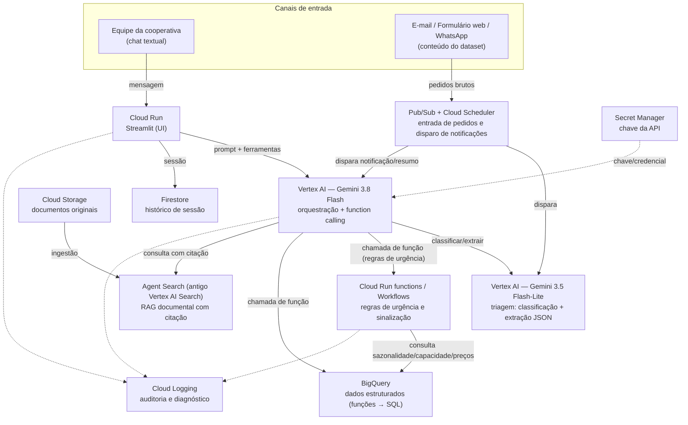
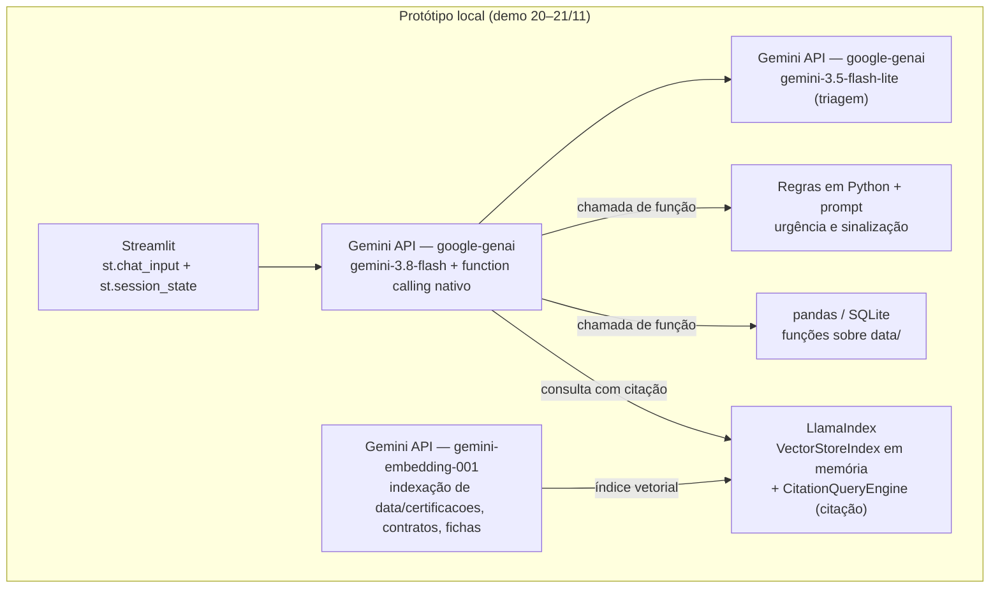

# 04 — Arquitetura de Referência Google e Decisões Iniciais por Componente

> **Rascunho da arquitetura** (Etapa 2, issue #2). A versão final, entregável
> obrigatório de 19/11/2026, parte deste documento e é registrada em #16.
> Segue a **diretriz permanente** de `docs/03-diretriz-arquitetura.md`:
> toda decisão é tomada pensando no ecossistema Google, e cada componente do
> protótipo tem um serviço Google Cloud correspondente, com justificativa e
> alternativa considerada — dentro **e** fora do Google — mesmo que o
> protótipo execute local.
>
> **Nomes de serviços conferidos na documentação oficial em 10/11/2026**
> (ver §7). Onde o nome mudou desde a divulgação do desafio, registramos
> "nome atual (nome na época)".

---

## 1. Stack do protótipo por camada (decisão da equipe)

A tabela da equipe — base de todas as decisões abaixo:

| Camada | Protótipo (local) | Serviço Google Cloud no desenho |
|---|---|---|
| Chat/UI | **Streamlit** (`st.chat_input`, `st.session_state`) | Cloud Run + UI |
| Modelo + agente | **Gemini API** (`google-genai`, function calling nativo) | Vertex AI (Gemini) |
| RAG documental | **LlamaIndex** + embeddings + busca com citação | Agent Search (antigo Vertex AI Search) |
| Dados estruturados | **pandas/SQLite** expostos como **funções** | BigQuery |
| Classificação de urgência | **regras + prompt** | Cloud Run functions / Workflows |

---

## 2. Tabela de mapeamento por componente

> Formato exigido pela diretriz (`docs/03`): componente local, serviço Google
> Cloud de produção, justificativa, alternativa considerada (com o motivo de
> não segui-la — princípio 3 do `docs/03`). As seis áreas citadas pela
> diretriz estão marcadas com **[área]**.

| Componente no protótipo (local) | Serviço Google Cloud (produção) | Justificativa | Alternativa considerada |
|---|---|---|---|
| **[área] Interface conversacional** — Streamlit (`st.chat_input`, `st.session_state`), chat textual em PT-BR para a equipe da cooperativa | **Cloud Run** (container com a UI) | Servidor de container gerenciado, escala a zero (custo ~0 fora do horário de uso) e publicação da UI sem gerenciar servidor — coerente com o papel do Cloud Run como "UI + entrada do assistente" | **Fora:** Gradio — mesma facilidade, mas menos controle de sessão/estado que o Streamlit e equipe já domina Streamlit. **Dentro:** Gemini Enterprise — dá chat pronto, mas o desafio exige construir o assistente (triagem, RAG, função) e não só consumir um produto fechado |
| **[área] Orquestração do assistente** — loop conversacional, **function calling nativo** via `google-genai`, contexto de sessão em `st.session_state` | **Vertex AI (Gemini)** — agente servido no Gemini | Function calling nativo evita parsing manual de JSON/regex e mantém o contexto da conversa no próprio modelo; Vertex AI dá IAM, identidade de serviço e régua de custos em produção | **Fora:** LangChain — camada de abstração a mais do que o protótipo precisa; o function calling nativo já resolve. Ollama (exemplo do `docs/03`) — exigiria infra de GPU fora do escopo. **Dentro:** Google ADK — dá mais estrutura (runners, sessões gerenciadas) do que o protótipo precisa; reavaliar na versão final (#16) se a orquestração crescer |
| **[área] Triagem de pedidos (Desafio A, parte 1)** — classificação do tipo de mensagem (compra × cotação × consulta × produtor × órgão) e extração estruturada (produtos, quantidades, prazos, comprador) com **Gemini Flash-Lite** + saída JSON | **Vertex AI (Gemini Flash-Lite)** | Volume alto de mensagens coloquiais por dia (60–100 na narrativa) pede modelo barato e rápido; Flash-Lite aguenta o volume no free tier e o PT-BR coloquial é ponto forte do Gemini | **Fora:** regex/spaCy — quebram com abreviação, erro de digitação e informação implícita, exatamente o requisito central. Ollama — infra de GPU fora do escopo. **Dentro:** Gemini Flash para tudo — gasta a quota restrita do Flash com volume que o Flash-Lite resolve (princípio de custo do `docs/03`) |
| **Classificação de urgência e sinalização (Desafio A, parte 2)** — regras determinísticas (prazo ≤ X dias, volume acima da capacidade, produto fora de safra, certificação vencida) + prompt para casos ambíguos | **Cloud Run functions / Workflows** | A urgência precisa ser **determinística e auditável** (regras de negócio em código), com o LLM só cobrindo a cauda ambígua — separar isso em função serverless mantém o custo baixo e a decisão rastreável | **Fora:** script cron no próprio servidor da UI — sem escalonamento e mistura responsabilidade de UI com regra de negócio. **Dentro:** só prompt, sem regras — não determinístico, dificulta avaliação (#6) e gasta quota do modelo com algo que uma regra resolve |
| **[área] RAG documental (Desafio B)** — ingestão/indexação de `data/certificacoes/`, `contratos/` e `fichas_tecnicas/`, busca semântica e resposta **com citação do documento de origem** (LlamaIndex `CitationQueryEngine` + embeddings do Gemini) | **Agent Search (antigo Vertex AI Search)** | Busca gerenciada do Google com ranking, snippets/answers e grounding — substitui o índice vetorial local sem operar infra de busca; nome vigente conferido em 10/11/2026 (o produto "Vertex AI Search" foi renomeado para "Agent Search") | **Fora:** implementação própria sem framework — reinventa chunking/reranking/citação que o LlamaIndex já entrega. ChromaDB + sentence-transformers — armazenamento vetorial local sem caminho direto para o mundo Google. **Dentro:** Vertex AI RAG Engine — gerenciado, mas menos controle sobre chunking/citação do que o LlamaIndex dá hoje; File Search da Gemini API — ótimo para protótipo rápido, porém amarra a troca ao ecossistema Gemini API. **Decisão registrada:** usar **LlamaIndex** no protótipo — corpus pequeno (20 documentos: 12 certificações, 3 contratos e 5 fichas), a citação do documento de origem é requisito central e o `CitationQueryEngine` entrega citação inline de graça, sem custo de serviço gerenciado |
| **[área] Comunicação com produtores (Desafio C)** — resumos personalizados (vendas, pendências, alocações) e notificações de novos pedidos, redigidos pelo Gemini Flash com **dados vindos de funções** (nunca calculados pelo LLM) | **Vertex AI (Gemini)** para redação + **Pub/Sub e Cloud Scheduler** para disparo agendado/por evento | A personalização é tarefa de linguagem (pertence ao Flash), mas os números vêm das funções de dados; Pub/Sub desacopla o gatilho (novo pedido, virada de mês) da redação e do envio | **Fora:** templates fixos em Python sem LLM — gera texto impessoal e quebra com vocabulário variado por produtor. Zapier/Make — dependência externa e custo por operação. **Dentro:** Agent Builder/Gemini Enterprise — produto fechado para chat corporativo, não para geração em lote de resumos por produtor |
| **[área] Dados estruturados** — `produtores.csv`, `financeiro.csv`, `sazonalidade.csv`, `tabela_precos`, `lotes.csv` carregados em **pandas/SQLite** e expostos ao agente como **funções** (function calling), nunca colados no prompt | **BigQuery** | Dados analíticos com SQL barato, escala para os 60–100 pedidos/dia e para histórico financeiro; o agente chama funções que traduzem para SQL em produção — mesmo desenho mental do protótipo | **Fora:** DuckDB/PostgreSQL rodando junto da UI — mistura dados operacionais com aplicação e não escala com a equipe toda usando. **Dentro:** Cloud SQL — banco relacional gerenciado, mas o perfil do uso é analítico (consultas de agregação, relatórios), não transacional |

> **As sete linhas acima cobrem as seis áreas exigidas pela diretriz**
> (triagem de pedidos, RAG documental, comunicação com produtores,
> orquestração, dados, interface) + a classificação de urgência, que a
> diretriz considera parte da triagem mas a equipe separou por ter
> implementação distinta (regras + prompt). Os **componentes de apoio**
> (só no desenho, sem protótipo local) têm tabela própria na §4.

---

## 3. Divisão de modelos (igual à estratégia de custo do `docs/03`)

| Papel no assistente | Modelo no protótipo | Serviço na produção |
|---|---|---|
| Triagem, classificação (compra × cotação × consulta × produtor × órgão) e extração estruturada | **Gemini Flash-Lite** (`gemini-3.5-flash-lite`) | Vertex AI (Gemini Flash-Lite) |
| Resposta final conversacional (RAG, relatórios, comunicação com produtores) | **Gemini Flash** (`gemini-3.8-flash`) | Vertex AI (Gemini) |
| Embeddings do RAG | **Gemini Embedding** (`gemini-embedding-001`, estável; `gemini-embedding-2` é o novo multimodal de abr/2026 — não é necessário para corpus só de texto) | Vertex AI (Gemini Embedding) / embeddings usados pelo Agent Search |

> **Atenção (conferido em 10/11/2026):** `gemini-2.5-flash` está deprecado e
> após 01/12/2026 passa a rotear para `gemini-3.5-flash-lite` — a stack acima
> já parte dos modelos vigentes para projetos novos (3.5 Flash-Lite e 3.8 Flash).
> Os limites de free tier de cada modelo **devem ser reconfirmados no AI
> Studio** — na configuração do ambiente (#3) e de novo antes da semana de
> ajuste fino (#14), conforme o `docs/03` — os números mudam com frequência.

---

## 4. Componentes de apoio (só no desenho)

Não fazem parte do protótipo local; entram no diagrama e na apresentação
como "como isso rodaria em produção":

| Serviço | Papel no desenho | Por que entra | Alternativa considerada |
|---|---|---|---|
| **Cloud Storage** | Guardar os documentos originais (certificações, contratos, fichas) que alimentam o RAG | O Agent Search ingere de buckets; hoje os docs estão no repositório | **Fora:** arquivos no próprio repositório/sistema de arquivos — mistura dado com código e não escala para as centenas de documentos da narrativa. **Dentro:** Google Drive — acessível, mas o ingestion do Agent Search consome bucket (e assim fica um único caminho de dados) |
| **Secret Manager** | Guardar a chave da API Gemini e credenciais | Chave nunca em variável de ambiente de produção nem no repositório (regra do `docs/03`) | **Fora:** variável de ambiente / arquivo `.env` no servidor — vaza em logs e backups. **Dentro:** chave da API do AI Studio — serve ao protótipo local, mas produção usa identidade de serviço (ADC/IAM), que é o par natural do Secret Manager para o que não vira identidade |
| **Firestore** | Histórico de sessão do assistente entre execuções | `st.session_state` é volátil e por processo; em produção a sessão precisa sobreviver a reinícios e escalar horizontalmente | **Fora:** sessão em memória do processo — perde o histórico a cada deploy/escala. **Dentro:** Cloud SQL — banco gerenciado, mas o modelo de documento do Firestore casa melhor com sessões de chat e evita schema para um dado descartável |
| **Pub/Sub + Cloud Scheduler** | Entrada de pedidos (e-mail/formulário/webhook) e disparo de notificações e relatórios periódicos | Desacopla canais de entrada do processamento e agenda o envio de resumos por produtor sem cron artesanal | **Fora:** cron + fila caseira no mesmo servidor — acopla agendamento ao processamento e falha junto com a UI. Zapier/Make — custo por operação e dependência externa. **Dentro:** Cloud Tasks — resolve disparo com atraso, mas não faz broadcast para múltiplos consumidores como o Pub/Sub |
| **Cloud Logging** | Log central de chamadas do agente, tools e erros | Auditoria das respostas (requisito de citação) e diagnóstico na semana de ajuste fino | **Fora:** log em arquivo dentro do container — perde-se com o ciclo da instância e não dá para auditar. **Dentro:** Cloud Trace/Cloud Monitoring — complementares (latência e alerta), não substituem o log central |

---

## 5. Princípios registrados (obrigatórios pela issue #2)

1. **Dado estruturado se consulta por função.** Tudo que está em
   `produtores.csv`, `financeiro.csv`, `sazonalidade.csv`, `tabela_precos` e
   `lotes.csv` é acessado por **funções expostas ao agente via function
   calling** — nunca colado no prompt nem "lembrado" pelo modelo.
2. **Texto livre vai para o RAG.** Perguntas sobre certificações,
   rastreabilidade, sazonalidade em documento, contratos e fichas técnicas
   são respondidas pelo RAG com **citação do documento de origem** — e, se o
   documento não existir, a resposta é "não encontrei" (requisito anti-alucinação).
3. **O LLM não faz contas.** Soma, comparação de datas, cálculo de pendência,
   margem e desconto de atacado são feitos por **código (pandas/regras)**; o
   modelo só narra o resultado. Isso é o que torna a resposta auditável e a
   urgência determinística.

---

## 6. Padrão de troca (local → Google)

Cada serviço externo fica **atrás de uma função/classe com interface única**
e **duas implementações**: a local (protótipo) e a de produção (Google).
A troca é **só configuração** — variável de ambiente / perfil no código, sem
refazer chamadas no resto do sistema:

| Interface | Versão local (protótipo) | Versão Google (produção) |
|---|---|---|
| `LLMClient` | `google-genai` → Gemini API (chave do AI Studio) | Vertex AI (Gemini) — mesma SDK, outra autenticação (ADC/IAM) |
| `EmbeddingClient` | `google-genai` → `gemini-embedding-001` | mesmo SDK / embeddings do Agent Search |
| `Retriever` (RAG) | LlamaIndex `VectorStoreIndex` em memória + `CitationQueryEngine` | Agent Search (ingestão via Cloud Storage, API `discoveryengine`) |
| `DadosRepository` | pandas/SQLite em `data/` | funções → SQL no BigQuery |
| `UrgenciaAvaliador` | regras em Python + prompt | Cloud Run functions (mesmo código de regras) / Workflows |
| `SessionStore` | `st.session_state` | Firestore |
| `NotificacoesDispatcher` | saída no console da UI | Pub/Sub → worker de envio |

Consequência prática: a demo roda no laptop sem conta Google Cloud
(custo zero, reproduzível), e a mesma base de código migra para o desenho de
produção trocando perfil de configuração — é isso que a apresentação de
10 minutos mostra como decisão de arquitetura.

---

## 7. Nomes de serviços conferidos na documentação oficial (10/11/2026)

| Nome no desenho | Nome vigente na documentação | Fonte |
|---|---|---|
| Cloud Run | **Cloud Run** | https://docs.cloud.google.com/run/docs |
| Cloud Functions / Workflows | **Cloud Run functions** (o antigo "Cloud Functions" é hoje "Cloud Run functions") e **Workflows** | https://docs.cloud.google.com/run/docs/functions-with-run |
| Vertex AI (Gemini) | **Vertex AI — Gemini models** | https://docs.cloud.google.com/vertex-ai/docs |
| Gemini API (`google-genai`) | **Gemini API** com SDK `google-genai` | https://ai.google.dev/gemini-api/docs |
| Modelos | **`gemini-3.5-flash-lite`** (Flash-Lite, estável), **`gemini-3.8-flash`** (Flash), `gemini-embedding-001` (estável) e `gemini-embedding-2` (multimodal, abr/2026) | https://ai.google.dev/gemini-api/docs/models |
| Vertex AI Search | **Agent Search** (renomeado; antes: Vertex AI Search / AI Applications / Agent Builder) — API subjacente `discoveryengine.googleapis.com` | https://docs.cloud.google.com/generative-ai-app-builder/docs |
| BigQuery, Cloud Storage, Secret Manager, Firestore, Pub/Sub, Cloud Scheduler, Cloud Logging | nomes inalterados | https://docs.cloud.google.com/docs |
| LlamaIndex | **LlamaIndex** (`llama-index-core` + `llama-index-embeddings-google-genai`; o pacote `llama-index-embeddings-gemini` foi descontinuado) + `CitationQueryEngine` para citação inline | https://developers.llamaindex.ai / repo `run-llama/llama_index` (v0.14.x) |

> Reavaliar esta tabela na Etapa 16 (documento final) — nomes e versões de
> modelo mudam rápido; a data da conferência é parte da evidência.

---

## 8. Diagrama

### 8.1 Visão de produção (mundo Google)



### 8.2 Execução local (simplificação da fase de demonstração)

> **Mesmos papéis, serviços substituíveis por configuração** (padrão de troca,
> §6). O protótipo roda no laptop: custo zero, zero conta Google Cloud,
> demo reproduzível — decisão prática do `docs/03` que **não invalida** o
> desenho de produção acima.



### 8.3 Referência de arquitetura RAG

Fonte consultada em 10/11/2026:
[RAG reference architectures (Google Cloud Architecture Center)](https://docs.cloud.google.com/architecture/rag-reference-architectures) —
o desenho de produção acima segue o perfil "managed search" (dados em
Cloud Storage + serviço gerenciado de busca com grounding), que é o caso do
Agent Search; as opções com banco vetorial (AlloyDB, Cloud SQL, Spanner Graph)
ficam registradas como caminho de evolução se a cooperativa quiser RAG sobre
dados operacionais.

---

### 8.4 Grounding e verificação de citações em produção (Etapa 8)

Em produção no Google Cloud, a pipeline local de consulta documental (sabor_da_terra/rag/responder.py + saída estruturada Pydantic com pós-validação de fontes) corresponde a dois recursos nativos da Vertex AI:

- **Respostas fundamentadas com citação via Agent Search (antigo Vertex AI Search):** o serviço recupera os trechos mais relevantes dos documentos armazenados no Cloud Storage e gera respostas com *extractive segments* e metadados de origem (*citations*), dispensando pós-processamento manual de índice local.
- **Check Grounding API da Vertex AI (groundingConfig / CheckGrounding):** valida automaticamente se cada afirmação gerada pelo Gemini possui suporte factual nos trechos recuperados (*grounding chunks*), atribuindo pontuações de suporte e bloqueando ou sinalizando afirmações sem lastro documental — equivalente gerenciado à nossa validação pós-geração de citações e política de lacuna (*"não encontrei essa informação nos documentos"*).

---

## 9. O que fica de fora desta etapa

- **Versão final do documento de arquitetura** → #16 (parte deste rascunho).
- **Artefatos de implantação** (Dockerfile, Terraform, definição do
  Workflows) → #15 — seguem a tabela da §2.
- **Implementação** → #3 em diante (o ambiente instala a stack decidida aqui).


## 10. Triagem Inteligente — Implementação Local (Issue #10)

### 10.1 Objetivo

A Triagem Inteligente transforma mensagens previamente estruturadas em uma fila de atendimento priorizada, acompanhada de avaliações comerciais, sugestões de alocação, alertas e referências às fontes utilizadas.

A implementação preserva a separação entre interpretação de linguagem natural e regras determinísticas de negócio. As decisões relativas a prazos, quantidades, capacidade produtiva e elegibilidade são calculadas em Python, sem delegar operações numéricas ao modelo de linguagem.

### 10.2 Fluxo de processamento

O processamento é iniciado pela função `triar_pendentes(data_referencia)`, implementada em `sabor_da_terra/triagem/fila.py`.

O fluxo compreende:

1. Carregamento dos pedidos estruturados em `tests/fixtures/triagem_15_pedidos.json`.
2. Recuperação dos metadados originais, incluindo datas de recebimento, a partir de `data/pedidos.json`.
3. Seleção das mensagens (pedidos e ofertas de produtores) recebidas até a data de referência.
4. Classificação e ordenação dos registros: prioridade pelas regras de urgência (horas desde `data_recebimento`, contrato e sinais do texto); na mesma prioridade, prazo mais cedo e menos horas até o prazo.
5. Avaliação das demandas e das condições comerciais. As regras da #5 são avaliadas na data em que o pedido chegou.
6. Geração de sugestões de alocação sujeitas à capacidade semanal e às restrições aplicáveis. Pedidos que aguardam confirmação também reservam capacidade (marcada como condicionada), e a demanda de todos os pedidos da semana é comparada com a capacidade documentada (`demanda_semanal`). Quando o contrato pede (Restaurante Raízes), produtores com orgânico vigente e do município do comprador vêm primeiro.
7. Análise de histórico e hipóteses documentais quando necessário.
8. Cruzamento informativo entre ofertas de produtores e demandas.
9. Consolidação dos alertas, com identificação das fontes.
10. Retorno da fila estruturada e geração de relatório em Markdown e JSON.

### 10.3 Componentes principais

| Componente | Responsabilidade |
|---|---|
| `triagem/fila.py` | Orquestração da triagem, priorização e consolidação da fila |
| `triagem/alocar.py` | Avaliação das sugestões de alocação e controle da capacidade semanal |
| `triagem/ofertas.py` | Identificação e cruzamento temporal de ofertas |
| `triagem/historico.py` | Consulta ao histórico e tratamento de referências ambíguas |
| `triagem/consultas.py` | Consultas auxiliares para demandas específicas |
| `triagem/notificacoes.py` | Preparação de informações e alertas relacionados às notificações |
| `triagem/exportar.py` | Geração do relatório Markdown |

### 10.4 Regras de negócio e rastreabilidade

A triagem considera informações de produtores, lotes, certificações, contratos, histórico e demais dados disponíveis no repositório.

As sugestões de atendimento não equivalem a reservas ou confirmações comerciais.

Quando uma informação não pode ser comprovada, o sistema deve preservar a incerteza e solicitar confirmação, em vez de apresentar hipóteses como fatos.

Os alertas devem identificar a origem documental ou estruturada que fundamenta a sinalização.

### 10.5 Compatibilidade temporal das ofertas

O cruzamento de ofertas é realizado por `identificar_ofertas()` e `cruzar_ofertas()`, em `triagem/ofertas.py`.

Uma oferta somente pode influenciar a triagem quando sua data de recebimento não é posterior à data de referência.

A compatibilidade com o prazo original da demanda é representada por três estados:

- `True`: oferta recebida até a data-limite da demanda.
- `False`: oferta recebida depois da data-limite.
- `None`: informações temporais insuficientes para verificar a compatibilidade.

Ofertas posteriores ao prazo original podem ser apresentadas para eventual renegociação, desde que já sejam conhecidas na data da triagem. Elas não representam disponibilidade confirmada.

**Exemplo:** o PED-015 foi recebido em 30/10/2026, às 16h. Portanto, não entra na fila nem no cruzamento realizado em 29/10/2026. Na triagem de 30/10, sua oferta de queijo coalho pode ser relacionada ao PED-006, mas é identificada como posterior ao prazo original de 29/10.

### 10.6 Histórico e ambiguidades

Referências como "o de sempre" ou "da última vez" exigem consulta a evidências históricas.

Quando não existe histórico suficiente, uma ficha técnica pode fundamentar uma hipótese documental, mas não comprova uma compra anterior.

O sistema deve registrar a fonte da hipótese e exigir confirmação antes de tratá-la como uma demanda plenamente identificada.

### 10.7 Saídas e confirmações

A função `triar_pendentes()` retorna uma estrutura contendo:

- `data_referencia`;
- `total_registros`;
- `fila`;
- `demanda_semanal`;
- `capacidade_semanal_sugerida`;
- `confirmacoes_realizadas`;
- `notificacoes_enviadas`.

As correspondências entre ofertas e demandas são informativas. A identificação de um produtor potencialmente apto não confirma estoque, entrega ou aceitação comercial.

Na implementação validada, os indicadores `confirmacoes_realizadas` e `notificacoes_enviadas` permanecem `False`.

O relatório de exemplo é gerado em `exemplos/fila_triagem.md`, com data de referência 30/10/2026 (primeiro dia em que as 15 mensagens já existem). `salvar_json` grava a mesma estrutura em JSON.

### 10.8 Validação

A execução de referência utiliza:

```python
from sabor_da_terra.triagem.fila import triar_pendentes

resultado = triar_pendentes("2026-10-30")
```

O processamento retorna 15 registros.

Na validação realizada em 15/11/2026, a suíte automatizada apresentou:

- **571 testes aprovados**;
- **3 testes ignorados**;
- **Nenhuma falha**.

Os testes incluem a prevenção de uso de ofertas futuras, a identificação de ofertas posteriores ao prazo original e a preservação de correspondências sem confirmação automática.

### 10.9 Integração com o ecossistema Google

A arquitetura mantém a separação entre a interpretação das mensagens pelo Gemini Flash-Lite e a execução das regras determinísticas em Python.

A urgência combina as duas partes. O **prompt** é a classificação `compra_urgente` que o Flash-Lite já faz na extração da Etapa 9, a partir do tom e de sinais como "HOJE" e "máxima urgência". As **regras** em `priorizar.py` calculam as horas até o prazo, dão peso ao contrato e conferem sinais textuais. A triagem não faz uma segunda chamada ao modelo por mensagem.

Sequência prevista no desenho de produção:

| Passo local | No desenho |
|---|---|
| Extração e classificação (Etapa 9) | Vertex AI (Gemini Flash-Lite) |
| `triar_pendentes`: carregar → classificar → avaliar → alocar → cruzar ofertas | Workflows orquestrando a sequência |
| `validar_item` / `verificar_conformidade` e `classificar_urgencia` | Cloud Run functions (uma por validação) |
| `AlocadorSemanal` e `resumir_demanda_semanal` | Cloud Run functions + BigQuery (demanda × capacidade da semana) |

Esse mapeamento representa a arquitetura prevista, não uma afirmação de que os serviços gerenciados já estejam implantados.
