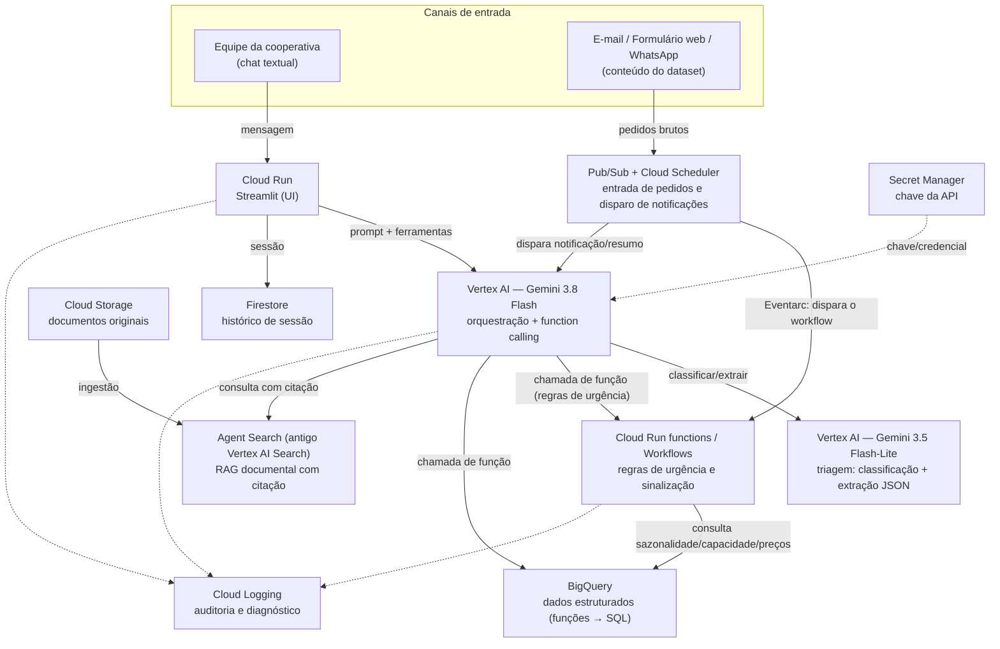
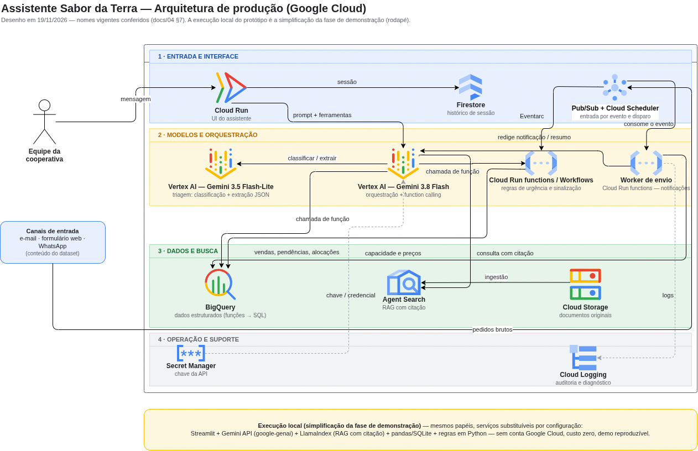
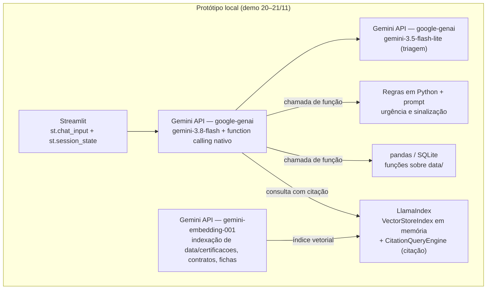
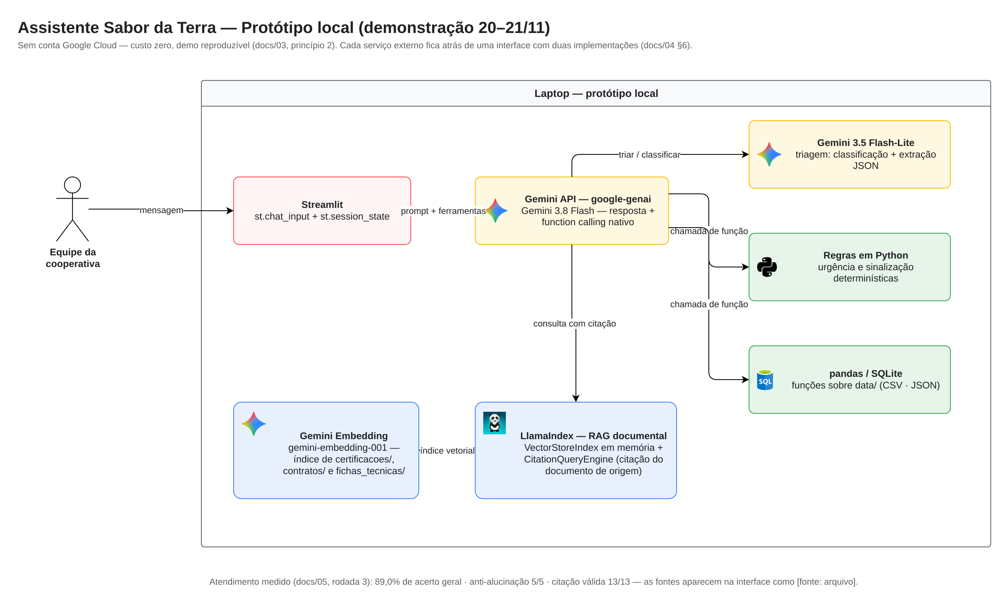
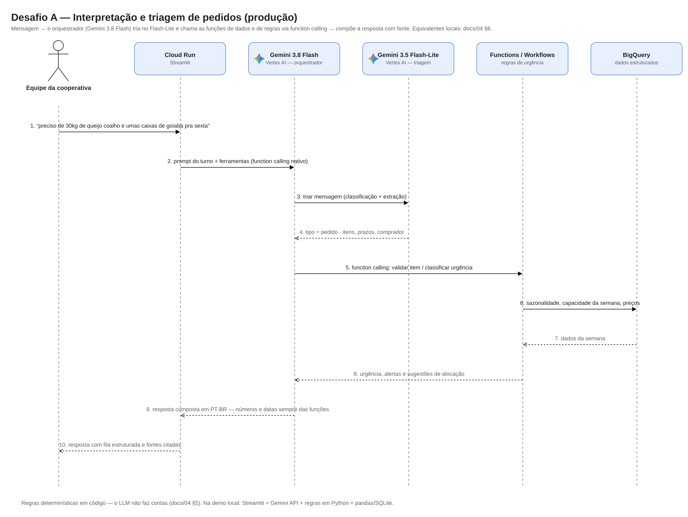
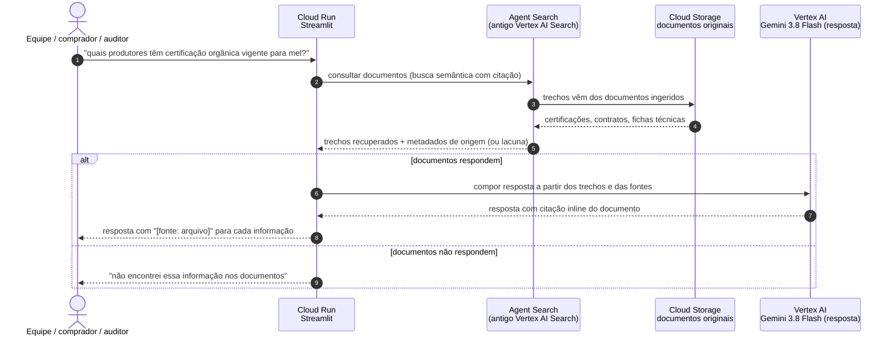
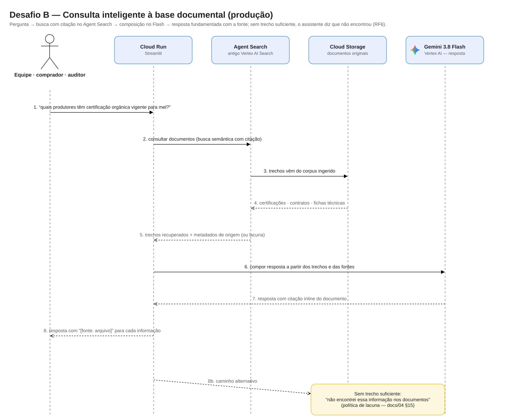
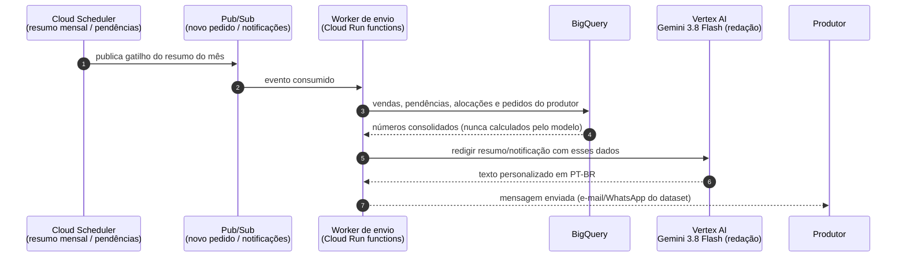
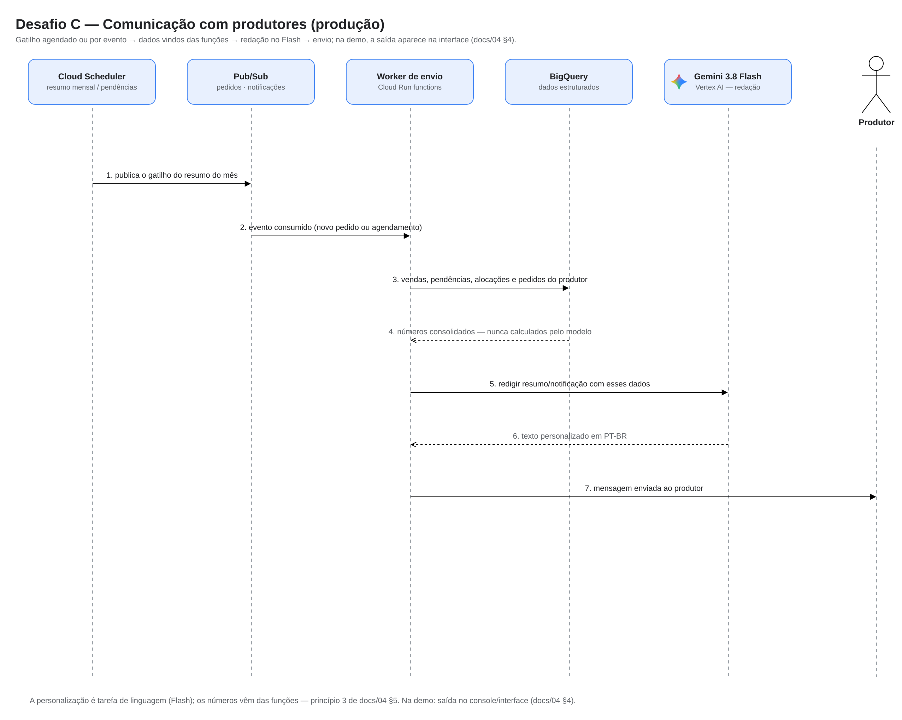

# 04 — Arquitetura de Referência Google e Decisões por Componente

> **Versão final** (etapa 16, issue #16), entregável obrigatório de
> **19/11/2026** — parte do rascunho da #2 e do que foi de fato implementado
> nas etapas 3 a 15. A partir de 19/11 o projeto está **congelado**:
> modificações posteriores são desconsideradas (`docs/01` §7–8). Segue a
> **diretriz permanente** de `docs/03-diretriz-arquitetura.md`: toda decisão
> é tomada pensando no ecossistema Google, e cada componente do protótipo tem
> um serviço Google Cloud correspondente, com justificativa e alternativa
> considerada — dentro **e** fora do Google — mesmo que o protótipo execute
> local.
>
> **Nomes de serviços conferidos na documentação oficial em 10/11/2026 e
> reavaliados na entrega desta versão, em 19/11/2026** (ver §7). Onde o nome
> mudou desde a divulgação do desafio, registramos "nome atual (nome na
> época)".

---

## Visão geral

O problema, os usuários, os desafios e os requisitos vêm do
`docs/01-documento-base.md` §3–§6; os números de atendimento vêm da avaliação
da etapa 14 (`docs/05-avaliacao.md`, rodada 3 de 19/11/2026).

**O problema.** A Cooperativa Sabor da Terra reúne 180 pequenos produtores
rurais (amostra do dataset: 18, `docs/01` §3) e comercializa frutas,
hortaliças, queijos e mel para restaurantes, mercados e programas de compra
governamental. Com demanda crescida 40% em dois anos, a operação artesanal
apresenta três dores simultâneas: pedidos que chegam por canais e formatos
imprevisíveis (60–100/dia) e hoje consomem o dia inteiro de triagem manual;
um acervo documental grande (certificações, laudos, contratos, fichas) em que
cada resposta leva horas para ser encontrada; e produtores "cegos", sem
visão de vendas, pendências e novos pedidos, hoje informados por telefone, um
a um.

**Os usuários.** A **equipe da cooperativa** (Dona Lúcia e Seu Antônio no
protótipo) usa o assistente por texto; **compradores, auditores e órgãos**
têm suas perguntas documentais respondidas com fonte citada; os
**produtores** recebem resumos e notificações gerados autonomamente.

**Os 3 desafios** (`docs/01` §5) e como o assistente os atende:

| Desafio | O que pede | Onde está no documento |
|---|---|---|
| **A — Interpretação e triagem de pedidos** | Classificar e extrair pedidos em linguagem natural coloquial, sinalizar urgência e problema (fora de safra, acima da capacidade) | §2 (triagem + urgência), §10 (implementação local) |
| **B — Consulta inteligente à base documental** | Responder sobre certificações, rastreabilidade, sazonalidade e lotes **com citação da fonte** e sem inventar | §2 (RAG documental), §15 (anti-alucinação) |
| **C — Comunicação com produtores** | Resumos personalizados por produtor e notificações claras de novos pedidos, redigidos pelo modelo com dados vindos de funções | §2 (comunicação), §4 (disparo) |

**Os 6 requisitos funcionais** (`docs/01` §6), com a evidência de atendimento
da rodada 3 (37 casos, 501 critérios; `docs/05`):

| Requisito | Como o assistente atende | Evidência (rodada 3) |
|---|---|---|
| RF1 — interface conversacional por texto | Streamlit (`st.chat_input`, `st.session_state`) | base de todos os 37 casos |
| RF2 — português coloquial (abreviação, erro, informação implícita) | triagem/extração no Gemini Flash-Lite | 90,3% (270/299); gírias e abreviações entendidas em todos os casos de robustez |
| RF3 — resposta documental com indicação da fonte | RAG LlamaIndex + `CitationQueryEngine`, citação `[fonte: …]` | 91,2% (166/182); 13/13 citações válidas |
| RF4 — relatórios e notificações autônomos | resumos e notificações por produtor (etapa 11), dados vindos de funções | 83,7% (36/43) |
| RF5 — contexto da sessão | histórico do turno no orquestrador + `st.session_state` | 66,7% (14/21) — limitação conhecida (§16) |
| RF6 — dizer claramente quando não sabe, sem inventar | política de lacuna do RAG + trava de fatos + trava de citação (§15) | 100% (32/32); casos de anti-alucinação 5/5 |

> Metas da #6 atingidas na rodada 3: **89,0%** de acerto geral (meta ≥ 85%),
> anti-alucinação **5/5** e citação válida em **13/13** respostas documentais.
> A arquitetura que produz esses números é a descrita nas seções seguintes;
> as limitações que restam estão na §16, idênticas às do `docs/05`.

---

## 1. Stack do protótipo por camada (decisão da equipe)

A tabela da equipe — base de todas as decisões abaixo:

| Camada | Protótipo (local) | Serviço Google Cloud no desenho |
|---|---|---|
| Chat/UI | **Streamlit** (`st.chat_input`, `st.session_state`) | Cloud Run + UI |
| Modelo + agente | **Gemini API** (`google-genai`, function calling nativo) | Vertex AI (Gemini) |
| RAG documental | **LlamaIndex** + embeddings + busca com citação | Agent Search (antigo Vertex AI Search) |
| Dados estruturados | **pandas/SQLite** expostos como **funções** | BigQuery |
| Classificação de urgência | **regras + prompt** | Cloud Run functions / Workflows |

---

## 2. Tabela de mapeamento por componente

> Formato exigido pela diretriz (`docs/03`): componente local, serviço Google
> Cloud de produção, justificativa, alternativa considerada (com o motivo de
> não segui-la — princípio 3 do `docs/03`). As seis áreas citadas pela
> diretriz estão marcadas com **[área]**.

| Componente no protótipo (local) | Serviço Google Cloud (produção) | Justificativa | Alternativa considerada |
|---|---|---|---|
| **[área] Interface conversacional** — Streamlit (`st.chat_input`, `st.session_state`), chat textual em PT-BR para a equipe da cooperativa | **Cloud Run** (container com a UI) | Servidor de container gerenciado, escala a zero (custo ~0 fora do horário de uso) e publicação da UI sem gerenciar servidor — coerente com o papel do Cloud Run como "UI + entrada do assistente" | **Fora:** Gradio — mesma facilidade, mas menos controle de sessão/estado que o Streamlit e equipe já domina Streamlit. **Dentro:** Gemini Enterprise — dá chat pronto, mas o desafio exige construir o assistente (triagem, RAG, função) e não só consumir um produto fechado |
| **[área] Orquestração do assistente** — loop conversacional, **function calling nativo** via `google-genai`, contexto de sessão em `st.session_state` | **Vertex AI (Gemini)** — agente servido no Gemini | Function calling nativo evita parsing manual de JSON/regex e mantém o contexto da conversa no próprio modelo; Vertex AI dá IAM, identidade de serviço e régua de custos em produção | **Fora:** LangChain — camada de abstração a mais do que o protótipo precisa; o function calling nativo já resolve. Ollama (exemplo do `docs/03`) — exigiria infra de GPU fora do escopo. **Dentro:** Google ADK — dá mais estrutura (runners, sessões gerenciadas) do que o protótipo precisa; reavaliar na versão final (#16) se a orquestração crescer |
| **[área] Triagem de pedidos (Desafio A, parte 1)** — classificação do tipo de mensagem (compra × cotação × consulta × produtor × órgão) e extração estruturada (produtos, quantidades, prazos, comprador) com **Gemini Flash-Lite** + saída JSON | **Vertex AI (Gemini Flash-Lite)** | Volume alto de mensagens coloquiais por dia (60–100 na narrativa) pede modelo barato e rápido; Flash-Lite aguenta o volume no free tier e o PT-BR coloquial é ponto forte do Gemini | **Fora:** regex/spaCy — quebram com abreviação, erro de digitação e informação implícita, exatamente o requisito central. Ollama — infra de GPU fora do escopo. **Dentro:** Gemini Flash para tudo — gasta a quota restrita do Flash com volume que o Flash-Lite resolve (princípio de custo do `docs/03`) |
| **Classificação de urgência e sinalização (Desafio A, parte 2)** — regras determinísticas (prazo ≤ X dias, volume acima da capacidade, produto fora de safra, certificação vencida) + prompt para casos ambíguos | **Cloud Run functions / Workflows** | A urgência precisa ser **determinística e auditável** (regras de negócio em código), com o LLM só cobrindo a cauda ambígua — separar isso em função serverless mantém o custo baixo e a decisão rastreável | **Fora:** script cron no próprio servidor da UI — sem escalonamento e mistura responsabilidade de UI com regra de negócio. **Dentro:** só prompt, sem regras — não determinístico, dificulta avaliação (#6) e gasta quota do modelo com algo que uma regra resolve |
| **[área] RAG documental (Desafio B)** — ingestão/indexação de `data/certificacoes/`, `contratos/` e `fichas_tecnicas/`, busca semântica e resposta **com citação do documento de origem** (LlamaIndex `CitationQueryEngine` + embeddings do Gemini) | **Agent Search (antigo Vertex AI Search)** | Busca gerenciada do Google com ranking, snippets/answers e grounding — substitui o índice vetorial local sem operar infra de busca; nome vigente conferido em 10/11/2026 (o produto "Vertex AI Search" foi renomeado para "Agent Search") | **Fora:** implementação própria sem framework — reinventa chunking/reranking/citação que o LlamaIndex já entrega. ChromaDB + sentence-transformers — armazenamento vetorial local sem caminho direto para o mundo Google. **Dentro:** Vertex AI RAG Engine — gerenciado, mas menos controle sobre chunking/citação do que o LlamaIndex dá hoje; File Search da Gemini API — ótimo para protótipo rápido, porém amarra a troca ao ecossistema Gemini API. **Decisão registrada:** usar **LlamaIndex** no protótipo — corpus pequeno (20 documentos: 12 certificações, 3 contratos e 5 fichas), a citação do documento de origem é requisito central e o `CitationQueryEngine` entrega citação inline de graça, sem custo de serviço gerenciado |
| **[área] Comunicação com produtores (Desafio C)** — resumos personalizados (vendas, pendências, alocações) e notificações de novos pedidos, redigidos pelo Gemini Flash com **dados vindos de funções** (nunca calculados pelo LLM) | **Vertex AI (Gemini)** para redação + **Pub/Sub e Cloud Scheduler** para disparo agendado/por evento | A personalização é tarefa de linguagem (pertence ao Flash), mas os números vêm das funções de dados; Pub/Sub desacopla o gatilho (novo pedido, virada de mês) da redação e do envio | **Fora:** templates fixos em Python sem LLM — gera texto impessoal e quebra com vocabulário variado por produtor. Zapier/Make — dependência externa e custo por operação. **Dentro:** Agent Builder/Gemini Enterprise — produto fechado para chat corporativo, não para geração em lote de resumos por produtor |
| **[área] Dados estruturados** — `produtores.csv`, `financeiro.csv`, `sazonalidade.csv`, `tabela_precos`, `lotes.csv` carregados em **pandas/SQLite** e expostos ao agente como **funções** (function calling), nunca colados no prompt | **BigQuery** | Dados analíticos com SQL barato, escala para os 60–100 pedidos/dia e para histórico financeiro; o agente chama funções que traduzem para SQL em produção — mesmo desenho mental do protótipo | **Fora:** DuckDB/PostgreSQL rodando junto da UI — mistura dados operacionais com aplicação e não escala com a equipe toda usando. **Dentro:** Cloud SQL — banco relacional gerenciado, mas o perfil do uso é analítico (consultas de agregação, relatórios), não transacional |

> **As sete linhas acima cobrem as seis áreas exigidas pela diretriz**
> (triagem de pedidos, RAG documental, comunicação com produtores,
> orquestração, dados, interface) + a classificação de urgência, que a
> diretriz considera parte da triagem mas a equipe separou por ter
> implementação distinta (regras + prompt). Os **componentes de apoio**
> (só no desenho, sem protótipo local) têm tabela própria na §4.

---

## 3. Divisão de modelos (igual à estratégia de custo do `docs/03`)

| Papel no assistente | Modelo no protótipo | Serviço na produção |
|---|---|---|
| Triagem, classificação (compra × cotação × consulta × produtor × órgão) e extração estruturada | **Gemini Flash-Lite** (`gemini-3.5-flash-lite`) | Vertex AI (Gemini Flash-Lite) |
| Resposta final conversacional (RAG, relatórios, comunicação com produtores) | **Gemini Flash** (`gemini-3.8-flash`) | Vertex AI (Gemini) |
| Embeddings do RAG | **Gemini Embedding** (`gemini-embedding-001`, estável; `gemini-embedding-2` é o novo multimodal de abr/2026 — não é necessário para corpus só de texto) | Vertex AI (Gemini Embedding) / embeddings usados pelo Agent Search |

> **Atenção (conferido em 10/11/2026):** `gemini-2.5-flash` está deprecado e
> após 01/12/2026 passa a rotear para `gemini-3.5-flash-lite` — a stack acima
> já parte dos modelos vigentes para projetos novos (3.5 Flash-Lite e 3.8 Flash).
> Os limites de free tier de cada modelo **devem ser reconfirmados no AI
> Studio** — na configuração do ambiente (#3) e de novo antes da semana de
> ajuste fino (#14), conforme o `docs/03` — os números mudam com frequência.

---

## 4. Componentes de apoio (só no desenho)

Não fazem parte do protótipo local; entram no diagrama e na apresentação
como "como isso rodaria em produção":

| Serviço | Papel no desenho | Por que entra | Alternativa considerada |
|---|---|---|---|
| **Cloud Storage** | Guardar os documentos originais (certificações, contratos, fichas) que alimentam o RAG | O Agent Search ingere de buckets; hoje os docs estão no repositório | **Fora:** arquivos no próprio repositório/sistema de arquivos — mistura dado com código e não escala para as centenas de documentos da narrativa. **Dentro:** Google Drive — acessível, mas o ingestion do Agent Search consome bucket (e assim fica um único caminho de dados) |
| **Secret Manager** | Guardar a chave da API Gemini e credenciais | Chave nunca em variável de ambiente de produção nem no repositório (regra do `docs/03`) | **Fora:** variável de ambiente / arquivo `.env` no servidor — vaza em logs e backups. **Dentro:** chave da API do AI Studio — serve ao protótipo local, mas produção usa identidade de serviço (ADC/IAM), que é o par natural do Secret Manager para o que não vira identidade |
| **Firestore** | Histórico de sessão do assistente entre execuções | `st.session_state` é volátil e por processo; em produção a sessão precisa sobreviver a reinícios e escalar horizontalmente | **Fora:** sessão em memória do processo — perde o histórico a cada deploy/escala. **Dentro:** Cloud SQL — banco gerenciado, mas o modelo de documento do Firestore casa melhor com sessões de chat e evita schema para um dado descartável |
| **Pub/Sub + Cloud Scheduler** | Entrada de pedidos (e-mail/formulário/webhook) e disparo de notificações e relatórios periódicos | Desacopla canais de entrada do processamento e agenda o envio de resumos por produtor sem cron artesanal | **Fora:** cron + fila caseira no mesmo servidor — acopla agendamento ao processamento e falha junto com a UI. Zapier/Make — custo por operação e dependência externa. **Dentro:** Cloud Tasks — resolve disparo com atraso, mas não faz broadcast para múltiplos consumidores como o Pub/Sub |
| **Cloud Logging** | Log central de chamadas do agente, tools e erros | Auditoria das respostas (requisito de citação) e diagnóstico na semana de ajuste fino | **Fora:** log em arquivo dentro do container — perde-se com o ciclo da instância e não dá para auditar. **Dentro:** Cloud Trace/Cloud Monitoring — complementares (latência e alerta), não substituem o log central |

---

## 5. Princípios registrados (obrigatórios pela issue #2)

1. **Dado estruturado se consulta por função.** Tudo que está em
   `produtores.csv`, `financeiro.csv`, `sazonalidade.csv`, `tabela_precos` e
   `lotes.csv` é acessado por **funções expostas ao agente via function
   calling** — nunca colado no prompt nem "lembrado" pelo modelo.
2. **Texto livre vai para o RAG.** Perguntas sobre certificações,
   rastreabilidade, sazonalidade em documento, contratos e fichas técnicas
   são respondidas pelo RAG com **citação do documento de origem** — e, se o
   documento não existir, a resposta é "não encontrei" (requisito anti-alucinação).
3. **O LLM não faz contas.** Soma, comparação de datas, cálculo de pendência,
   margem e desconto de atacado são feitos por **código (pandas/regras)**; o
   modelo só narra o resultado. Isso é o que torna a resposta auditável e a
   urgência determinística.

---

## 6. Padrão de troca (local → Google)

Cada serviço externo fica **atrás de uma função/classe com interface única**
e **duas implementações**: a local (protótipo) e a de produção (Google).
A troca é **só configuração** — variável de ambiente / perfil no código, sem
refazer chamadas no resto do sistema:

| Interface | Versão local (protótipo) | Versão Google (produção) |
|---|---|---|
| `LLMClient` | `google-genai` → Gemini API (chave do AI Studio) | Vertex AI (Gemini) — mesma SDK, outra autenticação (ADC/IAM) |
| `EmbeddingClient` | `google-genai` → `gemini-embedding-001` | mesmo SDK / embeddings do Agent Search |
| `Retriever` (RAG) | LlamaIndex `VectorStoreIndex` em memória + `CitationQueryEngine` | Agent Search (ingestão via Cloud Storage, API `discoveryengine`) |
| `DadosRepository` | pandas/SQLite em `data/` | funções → SQL no BigQuery |
| `UrgenciaAvaliador` | regras em Python + prompt | Cloud Run functions (mesmo código de regras) / Workflows |
| `SessionStore` | `st.session_state` | Firestore |
| `NotificacoesDispatcher` | saída no console da UI | Pub/Sub → worker de envio |

Consequência prática: a demo roda no laptop sem conta Google Cloud
(custo zero, reproduzível), e a mesma base de código migra para o desenho de
produção trocando perfil de configuração — é isso que a apresentação de
10 minutos mostra como decisão de arquitetura.

---

## 7. Nomes de serviços conferidos na documentação oficial (10/11/2026)

| Nome no desenho | Nome vigente na documentação | Fonte |
|---|---|---|
| Cloud Run | **Cloud Run** | https://docs.cloud.google.com/run/docs |
| Cloud Functions / Workflows | **Cloud Run functions** (o antigo "Cloud Functions" é hoje "Cloud Run functions") e **Workflows** | https://docs.cloud.google.com/run/docs/functions-with-run |
| Vertex AI (Gemini) | **Vertex AI — Gemini models** | https://docs.cloud.google.com/vertex-ai/docs |
| Gemini API (`google-genai`) | **Gemini API** com SDK `google-genai` | https://ai.google.dev/gemini-api/docs |
| Modelos | **`gemini-3.5-flash-lite`** (Flash-Lite, estável), **`gemini-3.8-flash`** (Flash), `gemini-embedding-001` (estável) e `gemini-embedding-2` (multimodal, abr/2026) | https://ai.google.dev/gemini-api/docs/models |
| Vertex AI Search | **Agent Search** (renomeado; antes: Vertex AI Search / AI Applications / Agent Builder) — API subjacente `discoveryengine.googleapis.com` | https://docs.cloud.google.com/generative-ai-app-builder/docs |
| BigQuery, Cloud Storage, Secret Manager, Firestore, Pub/Sub, Cloud Scheduler, Cloud Logging | nomes inalterados | https://docs.cloud.google.com/docs |
| LlamaIndex | **LlamaIndex** (`llama-index-core` + `llama-index-embeddings-google-genai`; o pacote `llama-index-embeddings-gemini` foi descontinuado) + `CitationQueryEngine` para citação inline | https://developers.llamaindex.ai / repo `run-llama/llama_index` (v0.14.x) |

> Reavaliada na etapa 16 (19/11/2026): os nomes da tabela continuam os
> vigentes na documentação oficial e o desenho de produção da §2/§4 os usa
> de forma coerente; a data da conferência é parte da evidência. O projeto
> congela em 19/11 (`docs/01` §7–8) — nova conferência completa só se o
> desenho voltar a evoluir depois do congelamento.

---

## 8. Diagrama

### 8.1 Visão de produção (mundo Google)



Versão draw.io (ícones oficiais do Google Cloud, editável em `docs/img/arquitetura-producao-google.drawio`):



### 8.2 Execução local (simplificação da fase de demonstração)

> **Mesmos papéis, serviços substituíveis por configuração** (padrão de troca,
> §6). O protótipo roda no laptop: custo zero, zero conta Google Cloud,
> demo reproduzível — decisão prática do `docs/03` que **não invalida** o
> desenho de produção acima.



Versão draw.io (editável em `docs/img/arquitetura-local.drawio`):



### 8.3 Referência de arquitetura RAG

Fonte consultada em 10/11/2026:
[RAG reference architectures (Google Cloud Architecture Center)](https://docs.cloud.google.com/architecture/rag-reference-architectures) —
o desenho de produção acima segue o perfil "managed search" (dados em
Cloud Storage + serviço gerenciado de busca com grounding), que é o caso do
Agent Search; as opções com banco vetorial (AlloyDB, Cloud SQL, Spanner Graph)
ficam registradas como caminho de evolução se a cooperativa quiser RAG sobre
dados operacionais.

---

### 8.4 Grounding e verificação de citações em produção (Etapa 8)

Em produção no Google Cloud, a pipeline local de consulta documental (sabor_da_terra/rag/responder.py + saída estruturada Pydantic com pós-validação de fontes) corresponde a dois recursos nativos da Vertex AI:

- **Respostas fundamentadas com citação via Agent Search (antigo Vertex AI Search):** o serviço recupera os trechos mais relevantes dos documentos armazenados no Cloud Storage e gera respostas com *extractive segments* e metadados de origem (*citations*), dispensando pós-processamento manual de índice local.
- **Check Grounding API da Vertex AI (groundingConfig / CheckGrounding):** valida automaticamente se cada afirmação gerada pelo Gemini possui suporte factual nos trechos recuperados (*grounding chunks*), atribuindo pontuações de suporte e bloqueando ou sinalizando afirmações sem lastro documental — equivalente gerenciado à nossa validação pós-geração de citações e política de lacuna (*"não encontrei essa informação nos documentos"*).

---

## 9. O que fica de fora deste documento

- **Slides da apresentação** → #18 (usam o diagrama e as decisões daqui).
- **Artefatos de implantação** (Dockerfile, Terraform, definição do
  Workflows) → #15 — seguem a tabela da §2 (detalhados na §11).
- **Implementação** → #3 em diante (o ambiente instala a stack decidida aqui).


## 10. Triagem Inteligente — Implementação Local (Issue #10)

### 10.1 Objetivo

A Triagem Inteligente transforma mensagens previamente estruturadas em uma fila de atendimento priorizada, acompanhada de avaliações comerciais, sugestões de alocação, alertas e referências às fontes utilizadas.

A implementação preserva a separação entre interpretação de linguagem natural e regras determinísticas de negócio. As decisões relativas a prazos, quantidades, capacidade produtiva e elegibilidade são calculadas em Python, sem delegar operações numéricas ao modelo de linguagem.

### 10.2 Fluxo de processamento

O processamento é iniciado pela função `triar_pendentes(data_referencia)`, implementada em `sabor_da_terra/triagem/fila.py`.

O fluxo compreende:

1. Carregamento dos pedidos estruturados em `tests/fixtures/triagem_15_pedidos.json`.
2. Recuperação dos metadados originais, incluindo datas de recebimento, a partir de `data/pedidos.json`.
3. Seleção das mensagens (pedidos e ofertas de produtores) recebidas até a data de referência.
4. Classificação e ordenação dos registros: prioridade pelas regras de urgência (horas desde `data_recebimento`, contrato e sinais do texto); na mesma prioridade, prazo mais cedo e menos horas até o prazo.
5. Avaliação das demandas e das condições comerciais. As regras da #5 são avaliadas na data em que o pedido chegou.
6. Geração de sugestões de alocação sujeitas à capacidade semanal e às restrições aplicáveis. Pedidos que aguardam confirmação também reservam capacidade (marcada como condicionada), e a demanda de todos os pedidos da semana é comparada com a capacidade documentada (`demanda_semanal`). Quando o contrato pede (Restaurante Raízes), produtores com orgânico vigente e do município do comprador vêm primeiro.
7. Análise de histórico e hipóteses documentais quando necessário.
8. Cruzamento informativo entre ofertas de produtores e demandas.
9. Consolidação dos alertas, com identificação das fontes.
10. Retorno da fila estruturada e geração de relatório em Markdown e JSON.

### 10.3 Componentes principais

| Componente | Responsabilidade |
|---|---|
| `triagem/fila.py` | Orquestração da triagem, priorização e consolidação da fila |
| `triagem/alocar.py` | Avaliação das sugestões de alocação e controle da capacidade semanal |
| `triagem/ofertas.py` | Identificação e cruzamento temporal de ofertas |
| `triagem/historico.py` | Consulta ao histórico e tratamento de referências ambíguas |
| `triagem/consultas.py` | Consultas auxiliares para demandas específicas |
| `triagem/notificacoes.py` | Preparação de informações e alertas relacionados às notificações |
| `triagem/exportar.py` | Geração do relatório Markdown |

### 10.4 Regras de negócio e rastreabilidade

A triagem considera informações de produtores, lotes, certificações, contratos, histórico e demais dados disponíveis no repositório.

As sugestões de atendimento não equivalem a reservas ou confirmações comerciais.

Quando uma informação não pode ser comprovada, o sistema deve preservar a incerteza e solicitar confirmação, em vez de apresentar hipóteses como fatos.

Os alertas devem identificar a origem documental ou estruturada que fundamenta a sinalização.

### 10.5 Compatibilidade temporal das ofertas

O cruzamento de ofertas é realizado por `identificar_ofertas()` e `cruzar_ofertas()`, em `triagem/ofertas.py`.

Uma oferta somente pode influenciar a triagem quando sua data de recebimento não é posterior à data de referência.

A compatibilidade com o prazo original da demanda é representada por três estados:

- `True`: oferta recebida até a data-limite da demanda.
- `False`: oferta recebida depois da data-limite.
- `None`: informações temporais insuficientes para verificar a compatibilidade.

Ofertas posteriores ao prazo original podem ser apresentadas para eventual renegociação, desde que já sejam conhecidas na data da triagem. Elas não representam disponibilidade confirmada.

**Exemplo:** o PED-015 foi recebido em 30/10/2026, às 16h. Portanto, não entra na fila nem no cruzamento realizado em 29/10/2026. Na triagem de 30/10, sua oferta de queijo coalho pode ser relacionada ao PED-006, mas é identificada como posterior ao prazo original de 29/10.

### 10.6 Histórico e ambiguidades

Referências como "o de sempre" ou "da última vez" exigem consulta a evidências históricas.

Quando não existe histórico suficiente, uma ficha técnica pode fundamentar uma hipótese documental, mas não comprova uma compra anterior.

O sistema deve registrar a fonte da hipótese e exigir confirmação antes de tratá-la como uma demanda plenamente identificada.

### 10.7 Saídas e confirmações

A função `triar_pendentes()` retorna uma estrutura contendo:

- `data_referencia`;
- `total_registros`;
- `fila`;
- `demanda_semanal`;
- `capacidade_semanal_sugerida`;
- `confirmacoes_realizadas`;
- `notificacoes_enviadas`.

As correspondências entre ofertas e demandas são informativas. A identificação de um produtor potencialmente apto não confirma estoque, entrega ou aceitação comercial.

Na implementação validada, os indicadores `confirmacoes_realizadas` e `notificacoes_enviadas` permanecem `False`.

O relatório de exemplo é gerado em `exemplos/fila_triagem.md`, com data de referência 30/10/2026 (primeiro dia em que as 15 mensagens já existem). `salvar_json` grava a mesma estrutura em JSON.

### 10.8 Validação

A execução de referência utiliza:

```python
from sabor_da_terra.triagem.fila import triar_pendentes

resultado = triar_pendentes("2026-10-30")
```

O processamento retorna 15 registros.

Na validação realizada em 15/11/2026, a suíte automatizada apresentou:

- **571 testes aprovados**;
- **3 testes ignorados**;
- **Nenhuma falha**.

Os testes incluem a prevenção de uso de ofertas futuras, a identificação de ofertas posteriores ao prazo original e a preservação de correspondências sem confirmação automática.

### 10.9 Integração com o ecossistema Google

A arquitetura mantém a separação entre a interpretação das mensagens pelo Gemini Flash-Lite e a execução das regras determinísticas em Python.

A urgência combina as duas partes. O **prompt** é a classificação `compra_urgente` que o Flash-Lite já faz na extração da Etapa 9, a partir do tom e de sinais como "HOJE" e "máxima urgência". As **regras** em `priorizar.py` calculam as horas até o prazo, dão peso ao contrato e conferem sinais textuais. A triagem não faz uma segunda chamada ao modelo por mensagem.

Sequência prevista no desenho de produção:

| Passo local | No desenho |
|---|---|
| Extração e classificação (Etapa 9) | Vertex AI (Gemini Flash-Lite) |
| `triar_pendentes`: carregar → classificar → avaliar → alocar → cruzar ofertas | Workflows orquestrando a sequência |
| `validar_item` / `verificar_conformidade` e `classificar_urgencia` | Cloud Run functions (uma por validação) |
| `AlocadorSemanal` e `resumir_demanda_semanal` | Cloud Run functions + BigQuery (demanda × capacidade da semana) |

Esse mapeamento representa a arquitetura prevista, não uma afirmação de que os serviços gerenciados já estejam implantados.

---

## 11. Caminho para produção (Etapa 15, issue #15)

> **Não executado no protótipo.** Os artefatos abaixo existem e foram
> validados localmente em 18/11/2026 (`docker build`, `terraform fmt`,
> `terraform validate` sem credenciais e `tests/test_infra.py`), mas nenhum foi
> aplicado num projeto Google Cloud: o protótipo roda local, sem conta nem
> billing (princípio 2 do `docs/03`). Os comandos `gcloud` desta seção são o
> roteiro de quem for implantar, não registro do que foi feito.

### 11.1 Artefatos

| Artefato | O que é | Validação local |
|---|---|---|
| `Dockerfile` (+ `.dockerignore`) | Imagem do Streamlit escutando em `$PORT` (8080 no Cloud Run), usuário sem privilégio, sem `.env` dentro | `docker build` e `docker run` com `/_stcore/health` respondendo `ok` |
| `infra/terraform/` | Os serviços do desenho, contas de serviço e IAM de menor privilégio; `project_id` e `region` sem valor | `terraform fmt -check` e `terraform validate` (Terraform 1.17.2, provider `google` 8.12.0) |
| `infra/workflows/triagem.yaml` | Fluxo de um pedido: extração → validações (regras da #5, por item, em paralelo) → urgência → alocação, espelhando `triagem/fila.py` (#10) | Leitura como YAML; as URLs das functions chegam pelas variáveis que o Terraform define |
| `infra/bigquery/*.json` | Esquema das 7 tabelas, gerado de `sabor_da_terra/dados/esquema.py` (#4) por `scripts/gerar_esquemas_bigquery.py` | `tests/test_infra.py` falha se o JSON sair de sincronia com o `esquema.py` |
| `infra/cloudbuild.yaml` | Pipeline testes (`LLM_MODO=fixture`) → build → push → deploy no Cloud Run | Leitura como YAML; o passo de testes é a suíte que já roda offline |

**Nomes das tabelas.** O esquema segue o modelo de dados da #4, que deu nome
às tabelas pelo conteúdo e não pelo arquivo de origem: `financeiro.csv` virou
`transacoes`, `tabela_precos_outubro_2026.csv` virou `produtos`, e
`produtor_produtos` liga cada produtor aos produtos do catálogo. As demais
(`produtores`, `pedidos`, `sazonalidade`, `lotes`) mantêm o nome.

### 11.2 Cobertura do desenho

Todo serviço da §2 e da §4 tem recurso Terraform ou o motivo de não ter:

| Serviço | Recurso Terraform | Observação |
|---|---|---|
| **Cloud Run** | `google_cloud_run_v2_service.app` (`run.tf`) | Afinidade de sessão e timeout de 3600 s para o websocket do Streamlit. Sem acesso público: login Google pelo IAP nativo do Cloud Run, liberado só para `membros_equipe` (só `run.invoker` não serviria, porque o navegador não manda token de identidade) |
| **Artifact Registry** | `google_artifact_registry_repository.app` (`run.tf`) | Repositório Docker das imagens do app |
| **Cloud Storage** | `google_storage_bucket.documentos` e `.codigo_funcoes` (`dados.tf`) | Acesso uniforme, sem acesso público, versionamento nos documentos |
| **BigQuery** | `google_bigquery_dataset.cooperativa` + uma `google_bigquery_table` por JSON de `infra/bigquery/` | App e functions só leem |
| **Agent Search (antigo Vertex AI Search)** | `google_discovery_engine_data_store.documentos` (`dados.tf`) | Só o data store; o app de busca com geração de resposta (nível pago) fica para quem implantar. A importação dos documentos do bucket para o data store é uma operação da API, sem recurso Terraform (comando na §11.3) |
| **Cloud Run functions** | `google_cloudfunctions2_function.triagem` (4: `extrair-pedido`, `validar-item`, `classificar-urgencia`, `alocar-semana`) | Só tráfego interno; só a conta do Workflows invoca. As regras da #5 ficam juntas em `validar-item`, porque a primeira fase delas é encadeada (cada regra só olha quem as anteriores não excluíram). O pacote com os pontos de entrada HTTP não foi escrito no protótipo |
| **Workflows** | `google_workflows_workflow.triagem` (`triagem.tf`) | Lê `infra/workflows/triagem.yaml`; o resultado fica na execução do workflow |
| **Secret Manager** | `google_secret_manager_secret.gemini_api_key` | Chave do AI Studio como plano B do Vertex AI, que usa a identidade da conta de serviço (sem chave). O valor entra fora do Terraform para não ficar no estado, e o segredo não vai montado no Cloud Run |
| **Firestore** | `google_firestore_database.sessoes` | Sessão do assistente (§4) |
| **Pub/Sub** | `google_pubsub_topic.pedidos` e `.notificacoes` | `google_eventarc_trigger.pedido_recebido` inicia o Workflows a cada pedido publicado. O tópico de notificações ainda não tem consumidor (§11.4) |
| **Cloud Scheduler** | `google_cloud_scheduler_job.produtores` (resumo mensal, pendências vencidas) | Publica no tópico de notificações |
| **Contas de serviço e IAM** | `iam.tf`: `sdt-app`, `sdt-funcoes`, `sdt-workflows`, `sdt-eventarc`, `sdt-deploy` | Sem papel básico; papel no recurso quando o recurso aceita IAM |
| **Vertex AI (Gemini)** | sem recurso | Modelo gerenciado não se cria: basta a API `aiplatform` ativa e `roles/aiplatform.user` nas contas que chamam o Gemini |
| **Cloud Logging** | sem recurso | Cloud Run, functions e Workflows já escrevem nele; as contas recebem `roles/logging.logWriter` |
| **Cloud Build** | sem recurso | O gatilho depende de conectar o repositório GitHub ao projeto (passo manual); a conta `sdt-deploy` e o `infra/cloudbuild.yaml` já estão prontos |

### 11.3 Comandos de implantação

> **Não executado no protótipo.** `<PROJETO>` e `<REGIAO>` são marcadores:
> nenhum ID de projeto real está versionado.

```bash
# 0. Projeto e credenciais (fora do repositório)
gcloud config set project <PROJETO>
gcloud auth application-default login
cd infra/terraform
cp terraform.tfvars.example terraform.tfvars   # preencher; o arquivo é ignorado pelo git
terraform init

# 1. Primeiro o que precisa existir antes do resto: o repositório de imagens e
#    o bucket do código das functions (o Cloud Run e as functions são criados
#    apontando para conteúdo que já tem de estar lá)
terraform apply \
  -target=google_artifact_registry_repository.app \
  -target=google_storage_bucket.codigo_funcoes
cd ../..
gcloud builds submit --tag <REGIAO>-docker.pkg.dev/<PROJETO>/sabor-da-terra/app:latest .
gcloud storage cp <PACOTE_DAS_FUNCTIONS>.zip gs://<PROJETO>-codigo-funcoes/funcoes/sabor_da_terra.zip   # pacote fora do escopo (§11.4)

# 2. Todo o resto da infraestrutura
cd infra/terraform
terraform plan -out=plano.tfplan
terraform apply plano.tfplan
cd ../..

# 3. Dados estruturados: um CSV por tabela, já limpo pela camada de dados (#4)
python -c "from sabor_da_terra.dados.carregamento import obter_base; from sabor_da_terra.dados.esquema import TABELAS; base = obter_base(); [getattr(base, t).to_csv(f'{t}.csv', index=False) for t in TABELAS]"
bq load --source_format=CSV --skip_leading_rows=1 \
  sabor_da_terra.produtores produtores.csv infra/bigquery/produtores.json
#    (repetir para produtor_produtos, produtos, sazonalidade, pedidos, transacoes e lotes)

# 4. Documentos do RAG: bucket → data store do Agent Search
gcloud storage cp -r data/certificacoes data/contratos data/fichas_tecnicas gs://<PROJETO>-documentos/
curl -X POST -H "Authorization: Bearer $(gcloud auth print-access-token)" \
  -H "Content-Type: application/json" \
  "https://discoveryengine.googleapis.com/v1/projects/<PROJETO>/locations/global/collections/default_collection/dataStores/sabor-da-terra-documentos/branches/default_branch/documents:import" \
  -d '{"gcsSource": {"dataSchema": "content", "inputUris": [
        "gs://<PROJETO>-documentos/certificacoes/*",
        "gs://<PROJETO>-documentos/contratos/*",
        "gs://<PROJETO>-documentos/fichas_tecnicas/*"]}}'

# 5. Plano B do Gemini (opcional): guardar a chave do AI Studio no segredo
printf '%s' "$GEMINI_API_KEY" | gcloud secrets versions add gemini-api-key --data-file=-

# 6. Deploys seguintes: testes → build → push → deploy (infra/cloudbuild.yaml),
#    de preferência por um gatilho do Cloud Build na branch main
gcloud builds submit --config infra/cloudbuild.yaml --substitutions=_REGIAO=<REGIAO> .

# 7. Workflows: execução manual de um pedido (o normal é chegar pelo Pub/Sub)
gcloud workflows run triagem-pedidos --location=<REGIAO> \
  --data='{"pedido_id": "PED-2026-001", "mensagem": "...", "data_recebimento": "2026-10-28T09:15:00"}'
gcloud pubsub topics publish pedidos-entrada --message='{"pedido_id": "...", "mensagem": "..."}'
```

Validação local, que é o que o protótipo de fato executa:

```bash
docker build -t sabor-da-terra .
docker run --rm -p 8080:8080 -e LLM_MODO=fixture sabor-da-terra   # http://localhost:8080

cd infra/terraform
terraform fmt -check -recursive ..
terraform init -backend=false
terraform validate                                   # sem credenciais e sem plan

python -m scripts.gerar_esquemas_bigquery            # após mudar dados/esquema.py
pytest tests/test_infra.py                           # esquemas em sincronia e nenhum segredo
```

### 11.4 Limitações desta etapa

- **Nada foi aplicado.** `terraform validate` confere a sintaxe e os
  esquemas dos recursos, não as cotas, as permissões do projeto nem a
  disponibilidade do Agent Search na região escolhida — isso só um `plan`
  contra a nuvem mostra.
- **As functions não têm código de entrada.** O Terraform e o Workflows
  definem as 4 functions e o contrato de cada chamada; os pontos de entrada
  HTTP que embrulham `extrair_pedido`, `verificar_conformidade`,
  `classificar_urgencia` e o `AlocadorSemanal` ficaram de fora. A alocação
  em especial precisa guardar a capacidade da semana fora da memória
  (BigQuery ou Firestore), porque cada execução do Workflows é independente.
- **Notificações sem consumidor.** O Scheduler e a UI publicam no tópico
  `notificacoes-produtores`, mas o worker que redige e envia as mensagens
  não existe: sem assinatura, o Pub/Sub descarta o que chega ali.
- **Cloud Build manual.** No `gcloud builds submit` com a conta `sdt-deploy`,
  ela também precisa ler o bucket onde o gcloud sobe o código
  (`<PROJETO>_cloudbuild`). O gatilho do GitHub não usa esse bucket.
- **Adaptadores Google fora do escopo.** Das versões de produção da §6, só
  existe o esboço do `VertexSearchAdapter` (`sabor_da_terra/adaptadores/google/`),
  sem chamada à API. `DadosRepository` sobre BigQuery e `SessionStore` sobre
  Firestore não foram escritos: o protótipo continua com pandas e
  `st.session_state`, e o Terraform só cria os recursos.

---

## 12. Diagramas de sequência dos 3 desafios

> Visão de produção (mundo Google); os equivalentes locais de cada
> participante são as interfaces da §6 — a mesma sequência roda no protótipo
> trocando só os serviços. As versões editáveis em draw.io (com os logos
> das ferramentas) estão em `docs/img/`, referenciadas após cada diagrama.

### 12.1 Desafio A — Interpretação e triagem de pedidos

Mensagem coloquial → triagem no Flash-Lite → function calling para as funções
de dados e de regras → composição da resposta no Flash → resposta com fonte.

```mermaid
sequenceDiagram
    autonumber
    actor U as Equipe da cooperativa
    participant UI as Cloud Run<br/>Streamlit
    participant TR as Vertex AI<br/>Gemini 3.5 Flash-Lite (triagem)
    participant FN as Cloud Run functions /<br/>Workflows (regras)
    participant BQ as BigQuery
    participant GM as Vertex AI<br/>Gemini 3.8 Flash (resposta)
    U->>UI: "preciso de 30kg de queijo coalho e umas caixas de goiaba pra sexta"
    UI->>TR: triar mensagem (classificação + extração JSON)
    TR-->>UI: tipo = pedido de compra; itens, prazos, comprador
    UI->>FN: function calling: validar item / classificar urgência (regras determinísticas)
    FN->>BQ: sazonalidade, capacidade da semana, preços
    BQ-->>FN: dados da semana
    FN-->>UI: urgência, alertas e sugestões de alocação
    UI->>GM: compor resposta com o que as funções devolveram
    GM-->>UI: resposta em PT-BR (números e datas sempre das funções)
    UI-->>U: resposta com fila estruturada e fontes citadas
```

Versão draw.io (editável em `docs/img/sequencia-desafio-a.drawio`):



### 12.2 Desafio B — Consulta inteligente à base documental

Pergunta → busca com citação no Agent Search → composição no Flash → resposta
fundamentada com citação do documento de origem; se os documentos não
respondem, o assistente diz que não encontrou (§15).



Versão draw.io (editável em `docs/img/sequencia-desafio-b.drawio`):



### 12.3 Desafio C — Comunicação com produtores

Gatilho agendado ou por evento → dados vindos das funções → redação no Flash →
envio; na demo, a saída aparece na interface (§4).



Versão draw.io (editável em `docs/img/sequencia-desafio-c.drawio`):



---

## 13. Google Cloud Well-Architected Framework

> Uma decisão concreta por pilar, ancorada no que está no repositório ou
> registrado neste documento. Fonte: Google Cloud Well-Architected Framework
> (perspectiva de IA e ML), consultado em 19/11/2026.

| Pilar | Decisão concreta | Onde está |
|---|---|---|
| **Excelência operacional** | Toda a infraestrutura do desenho existe como **Terraform revisável** (`infra/terraform/` — `fmt`/`validate` passando) e o deploy segue pipeline **testes → build → push → deploy** (`infra/cloudbuild.yaml`) com a suíte rodando **offline em `LLM_MODO=fixture`** antes de qualquer publicação; diagnóstico central no **Cloud Logging** | §11.1, §11.2, §4 |
| **Segurança e privacidade** | O Cloud Run **não tem acesso público**: login Google pelo IAP nativo, liberado só ao grupo `membros_equipe`; a chave da API vive no **Secret Manager** (nunca `.env` em produção nem no repositório); IAM de **menor privilégio** por conta de serviço, sem papel básico (`iam.tf`); produção usa identidade de serviço (ADC/IAM), não chave | §11.2 (run.tf, iam.tf), §4 (Secret Manager) |
| **Confiabilidade** | Pedidos entram por **Pub/Sub** (Eventarc → Workflows), desacoplando canais do processamento com retry e sem depender da UI estar de pé; a sessão do assistente persiste no **Firestore**, sobrevivendo a reinícios e escala horizontal; as regras de urgência são **determinísticas em código**, reexecutáveis e auditáveis | §4 (Pub/Sub + Scheduler, Firestore), §2 (urgência) |
| **Otimização de custo** | **Cloud Run escala a zero** (custo ~0 fora do horário de uso); divisão de modelos **Flash-Lite para volume / Flash para resposta** herdada do `docs/03`; dados analíticos em **BigQuery** (SQL barato); no protótipo, free tier com plano B de US$ 5 — a estimativa de produção na escala da narrativa fica abaixo de US$ 30/mês (§14) | §1, §2, §14, `docs/03` |
| **Desempenho** | **Function calling nativo** com saída JSON estruturada em um turno; modelo por papel (triagem no Flash-Lite, resposta no Flash) em vez de um modelo caro para tudo; agregações (soma, comparação de datas, pendências) em **SQL/código**, nunca no modelo — o contexto da conversa fica enxuto e a resposta sai auditável | §2, §5 (princípios 1 e 3) |
| **Sustentabilidade** | Sem infraestrutura própria (nada de GPUs ou servidores ociosos): serviços gerenciados que **escalam a zero**, região única (`southamerica-east1`, próxima dos usuários) e corpus pequeno (dezenas de documentos) indexado em serviço gerenciado em vez de cluster vetorial dedicado | §11.2, §14 |

---

## 14. Custo

### 14.1 Estratégia do protótipo — referência (sem duplicar)

A estratégia de custo do protótipo é a do `docs/03` ("Estratégia de custo —
API do Gemini (free tier)") e não é duplicada aqui: divisão de trabalho entre
modelos (Flash-Lite para volume, Flash para resposta, Embedding para
indexação), regras de desenvolvimento (não gastar cota do Flash com
iteração, fixtures gravadas em teste, chave restrita) e plano B (billing
com prepay de US$ 5). Os limites vigentes confirmados no projeto estão na
tabela do `docs/03` e foram reconfirmados na semana de ajuste fino (#14) —
o teste de cota da demo (`docs/05`) fechou em 16 chamadas Flash-Lite e
6 Flash por demo.

### 14.2 Estimativa de produção na escala do `docs/01`

> Narrativa do desafio: **180 produtores**, **60–100 pedidos/dia**, 12
> municípios. Preços de referência públicos, conferidos em **19/11/2026**
> (páginas de preço do Google Cloud e da Gemini API) — **confirmar no Price
> Calculator antes de qualquer decisão de billing**: preços mudam, o
> endpoint regional (`southamerica-east1`, não-global) custa ~10% a mais nos
> modelos e o promocional do Flash 3.8 vale até 31/12/2026.

Preços usados (endpoint global, USD por 1M de tokens):

| Modelo | Entrada | Saída | Uso no desenho |
|---|---|---|---|
| Gemini 3.5 Flash-Lite | $0,30 | $2,50 | triagem, roteamento, juiz de avaliação |
| Gemini 3.8 Flash | $0,75 | $3,75 (promo até 31/12/2026) | resposta conversacional e redação |
| Agent Search (Standard) | $1,50 / 1.000 consultas | — | RAG documental com citação |

Hipóteses de volume por dia (fechado no 100 pedidos, teto da narrativa):

| Uso | Chamadas/dia | Tokens/dia (entrada + saída) | Custo/dia |
|---|---|---|---|
| Triagem e extração (Flash-Lite) | ~100 mensagens | ~200K + ~80K | ~$0,26 |
| Respostas conversacionais (Flash) | ~60 turnos | ~240K + ~36K | ~$0,29 |
| Notificações e resumos (Flash) | ~100 + resumo mensal dos 180 produtores (~6/dia na média) | ~156K + ~43K | ~$0,29 |
| Consultas documentais (Agent Search Standard) | ~40 consultas | ~2 MB de índice | $0 — dentro de 10.000 consultas e 10 GiB grátis/mês |
| Embeddings e indexação | incremental | trivial | ~$0 |
| **Total de tokens e busca** | | | **~$0,84/dia** |

Itens de infraestrutura (todos com free tier ou volume ínfimo): Cloud Run
escala a zero com poucas sessões simultâneas da equipe (< US$ 10/mês);
BigQuery dentro do nível gratuito (10 GB de armazenamento, 1 TB de consulta
mês); Cloud Storage (~2 MB de documentos), Firestore, Pub/Sub, Cloud
Scheduler, Secret Manager e Cloud Logging em volumes de centavos.

**Ordem de grandeza da produção: < US$ 30/mês** (~US$ 25/mês + 10% do
endpoint regional), dominado pelos tokens do Gemini. A comparação que
interessa à apresentação: **a operação completa em produção custa por mês o
que o plano B do protótipo custa em uma única reserva** (US$ 5 de prepay), e
atriagem de um dia inteiro de trabalho manual (Dona Lúcia e Seu Antônio) sai
por menos de um dólar de modelo. O item que pode deslanchar o orçamento é o
Agent Search **Enterprise** (US$ 4/1.000 consultas, com respostas geradas) —
para o caso da cooperativa, o Standard, com citações nos trechos, já atende o
requisito de fonte (§15).

---

## 15. Anti-alucinação: citação validada no protótipo e em produção

> Requisito 6 do `docs/01` ("dizer claramente, sem inventar") e requisito 3
> ("indicando de qual documento veio a informação"). Evidência de
> atendimento: RF6 **100%** (32/32), anti-alucinação **5/5** e citação
> válida em **13/13** (`docs/05`, rodada 3).

### 15.1 Como o protótipo valida hoje

1. **O RAG só responde com trechos recuperados.** O `CitationQueryEngine`
   (LlamaIndex) compõe a resposta a partir dos documentos recuperados e
   anota a citação do arquivo de origem; o módulo de resposta
   (`sabor_da_terra/rag/responder.py`) roda uma pós-validação em Pydantic
   das fontes da saída estruturada.
2. **Política de lacuna.** Quando os documentos não cobrem a pergunta, a
   resposta é **"não encontrei essa informação nos documentos"** — o campo de
   lacunas do RAG chega à tela (correção da rodada 3, `docs/05`) e a resposta
   recomenda a verificação caso a caso em vez de apresentar hipótese como
   fato (princípio de `triagem/` §10.4).
3. **Trava de fatos** (`sabor_da_terra/assistente/verificacao.py`). Código
   (P003, PED-…, LOT-…, FIN-…), valor em R$ ou data completa que **não veio
   das funções do turno** é removido da resposta, que então avisa o usuário.
   Também remove total calculado pelo modelo (o LLM não faz contas, §5).
4. **Trava de citação.** Uma citação `[fonte: …]` de arquivo que as funções
   não devolveram sai do texto (a rodada 1 tinha citado um CSV que não
   existe; corrigido e avaliado em 13/13 desde a rodada 2).
5. **Avaliação permanente.** O gabarito da #6 mede anti-alucinação e citação
   a cada rodada (`tests/test_gabarito.py`), com as falhas anotadas com causa.

### 15.2 O equivalente em produção (Google Cloud)

Em produção, a pipeline local de consulta documental corresponde a dois
recursos nativos (detalhes técnicos na §8.4):

- **Agent Search (antigo Vertex AI Search) com respostas fundamentadas:**
  o serviço recupera os trechos mais relevantes dos documentos no Cloud
  Storage e gera respostas com *extractive segments* e metadados de origem
  (*citations*), dispensando o pós-processamento manual de índice local.
- **Check Grounding API da Vertex AI:** valida automaticamente se cada
  afirmação gerada pelo Gemini tem suporte factual nos trechos recuperados
  (*grounding chunks*), com pontuações de suporte — afirmações sem lastro
  são sinalizadas ou bloqueadas.

Mapeamento mecanismo a mecanismo:

| Mecanismo no protótipo (§15.1) | Equivalente gerenciado em produção |
|---|---|
| Trechos do RAG + citação do arquivo (`CitationQueryEngine`) | *Extractive segments* + *citations* nativas do Agent Search |
| Trava de fatos e trava de citação (`assistente/verificacao.py`) | **Check Grounding API** (pontuação de suporte por afirmação) |
| Política de lacuna — "não encontrei nos documentos" | Resposta sem lastro do serviço de busca (sem *grounding chunks* suficientes) |
| "O LLM não faz contas" — cálculo em código (§5) | Regras determinísticas em **Cloud Run functions** sobre o BigQuery (§2) |

---

## 16. Limitações e próximos passos

> As limitações são **as mesmas do `docs/05-avaliacao.md` §Limitações
> conhecidas** (texto idêntico); os próximos passos derivam delas e da
> §11.4. Nada do que se segue muda o desenho congelado em 19/11 — vale para
> o que vier depois da apresentação.

### 16.1 Limitações conhecidas (idênticas ao `docs/05`)

- **Encadeamento de funções.** Continua sendo a maior causa de falha (16 de
  25). Mensagens de produtor (`TRI-012`, `TRI-015`) não passam pela triagem, e
  pedidos que exigem cadastro, lotes e documentos ao mesmo tempo (`TRI-009`,
  `TRI-014`) ficam com parte das consultas por fazer.
- **Detalhes omitidos em pedidos longos.** Em pedidos com muitos itens e
  exigências (`TRI-007`, `TRI-013`), itens opcionais e dados do evento podem
  ficar de fora da resposta.
- **Contexto entre turnos (RF5).** Em 2 de 3 casos o segundo turno perde
  parte do que o primeiro estabeleceu; não foi corrigido nesta etapa.
- **Recuperação de contratos.** A busca documental não traz os contratos
  institucionais (PNAE) em `DOC-003` nem na notificação da ADAGRO (`TRI-014`),
  que responde que não os encontrou embora existam em `data/contratos/`.
- **Avaliação só no Flash-Lite.** A composição da demo usa o Flash, que não
  foi medido no gabarito por causa da cota. O resultado da demo tende a ser
  igual ou melhor, mas não está medido.
- **Juiz LLM.** Os vereditos são do Flash-Lite, com regras explícitas e a
  evidência de cada critério gravada, mas não foram revisados um a um por uma
  pessoa. No `TRI-014`, por exemplo, o juiz contou nomes e códigos de
  produtores como "dado pessoal exposto", embora a resposta não traga CPF,
  endereço nem dado bancário.
- **Lote inexistente na demo.** Ao não achar o `LOT-2024-089`, o assistente
  sugere o `LOT-2026-0089` e já mostra os dados dele. Está sinalizado ("não foi
  encontrado"), mas o roteiro da #18 deve deixar claro que é uma sugestão.

### 16.2 Próximos passos

| Limitação | Próximo passo |
|---|---|
| Encadeamento de funções | Revisar o roteamento do orquestrador e, se a orquestração crescer, reavaliar o Google ADK (decisão registrada na §2) |
| Contexto entre turnos (RF5) | Persistir o resumo da sessão entre turnos — em produção, o `SessionStore` sobre Firestore já está no desenho (§4/§6) |
| Recuperação de contratos | Ajustar a ingestão/chunking dos contratos institucionais; em produção, o import do bucket para o data store do Agent Search (§11.3) recupera o corpus inteiro |
| Avaliação só no Flash-Lite | Rodar o gabarito contra o Flash (ou contra o fallback Flash-Lite do turno) quando a cota ou o plano B do `docs/03` permitir |
| Juiz LLM | Revisão humana amostral dos vereditos, priorizando os casos reprovados com causa "orquestração" |
| Lote inexistente na demo | Manter no roteiro da #18 que a sugestão do lote parecido é sugestão, não resposta |
| Adaptadores e functions sem código (§11.4) | Escrever os pontos de entrada HTTP das 4 functions e os adaptadores `DadosRepository` (BigQuery) e `SessionStore` (Firestore) quando houver projeto Google Cloud para implantar |
